# MRU na plataforma: da chegada ao dado no HMS

Guia para quem vem da eletrônica e da programação e nunca embarcou. Junta tudo o que a pasta `Katia/` traz (três
manuais da Kongsberg, três vídeos e uma imagem), explica o caminho completo do MRU — da caixa de transporte até o
número que aparece na tela do HMS — e termina comparando com o nosso MRU (`Hardware/Embedded/Main`, firmware v1.0.8).

Compilado em 03/11/2026.

---

## 0. Como conferir as fontes

Cada afirmação traz, entre parênteses, o documento e a página (ou o minuto:segundo do vídeo).

| Citação | Arquivo em `Katia/` | O que é |
|---|---|---|
| **373945E** | `10.1 - 373945E.pdf` (idêntico a `11.1` e `12.1`, mesmo MD5) | *MRU 5th generation — User Manual*, Kongsberg Seatex, MRU-D-210 rev. 5.0, 26/03/2015. Vale para todos os modelos (5+, 5, E, H, 3, 2, D). |
| **374199E** | `11.2 - 374199E.pdf` (idêntico a `12.2`) | *MRU 5 — Installation Manual*, MRU-D-202 rev. 5.0, nov/2014. Instalação, cabos, configuração, protocolos. |
| **374716E** | `10.2 - 374716E.pdf` | *MRU 2 — Installation Manual*, MRU-D-206 rev. 5.0, nov/2014. Igual ao do MRU 5, mas para o modelo que **não mede heave**. |
| **Vídeo_1** | `Vídeo_1.mp4` (3 s, sem fala) | Sensor Teledyne TSS DMS-25 instalado. |
| **Vídeo_2** | `Vídeo_2.mp4` (36 s, sem fala) | DMS-25 instalado + segundo DMS-25 em bancada (fonte e notebook). |
| **Vídeo_3** | `Vídeo_3.mp4` (35 s, só ruído de fundo, nenhuma fala aproveitável) | As duas unidades lado a lado, terminal recebendo dados. |
| **Imagem_1** | `Imagem_1.jpeg` | Print do celular da chefe com a p. 49 do 373945E aberta (procedimento de inspeção de chegada). |

- **Página = página do leitor de PDF**, não a do rodapé. Nos três manuais o número impresso no rodapé é a página do
  leitor **menos 4** (ex.: rodapé 117 = p. 121).
- Vídeos: `mm:ss` do início do arquivo.
- Fora da pasta `Katia/` usei só a norma brasileira de helideque, **N223** = `Documents/Compare/Norma/normam-223.pdf`
  (página do leitor de PDF), e o código do repositório (`caminho:linha`). Conhecimento que não está em nenhum
  arquivo vem marcado como **[externo]**.
- O que é dedução minha, e não está escrito em lugar nenhum, vem marcado como **[interpretação]**.
- As figuras foram recortadas dos PDFs e dos vídeos para `Katia/figuras/`; o nome de cada uma diz de onde veio.

**[interpretação]** A numeração dos arquivos (10, 11 e 12, cada um com `.1` e `.2`) tem cara de lista de documentos
de um *data book* de três equipamentos: o item 10 é um **MRU 2** e os itens 11 e 12 são **MRU 5**, cada um com o
manual do usuário (`.1`, o mesmo nos três) e o manual de instalação do modelo (`.2`).

---

## 1. Resumo em um minuto

1. O **MRU** (*Motion Reference Unit*) é uma caixa com 3 giroscópios e 3 acelerômetros que calcula, 200 vezes por
   segundo, a inclinação da embarcação (roll e pitch), a guinada relativa (yaw) e o sobe-e-desce (heave) num ponto
   escolhido (373945E p. 23; 374199E p. 19).
2. Ele chega de fábrica **calibrado** (certificado individual + arquivo de calibração), numa caixa de transporte que
   precisa ser guardada para manter a garantia (373945E p. 13–14, p. 19, p. 21).
3. Na chegada faz-se um **teste rápido com PC** (373945E p. 48–50) — é a página que a chefe mandou no print
   (Imagem_1).
4. A equipe de bordo **mede** onde o MRU vai ficar em relação à origem do navio e ao helideque (*survey*), **fixa** o
   sensor num suporte com a seta X para a proa, **liga** o cabo a uma caixa de junção e dali ao computador do HMS
   (374199E p. 28–50).
5. No software de configuração (MRC+) informa-se posição, ângulos de montagem, ponto de interesse (centro do
   helideque), filtro de heave e formato/baud de saída (374199E p. 57–88).
6. Ligado, o MRU leva até **15 min** para atingir a precisão total e depois transmite sozinho, sem ninguém mexer
   (373945E p. 40).
7. O **HMS** (*Helideck Monitoring System*) lê esse fluxo pela serial (ou rede), guarda os últimos 20 min, calcula
   balanço, caturro, inclinação, arfagem, velocidade de arfagem e SHR no centro do helideque, compara com a tabela
   da NORMAM-223 e acende **luz verde ou vermelha** para pouso; o radioperador passa esses números ao piloto (N223
   p. 74, p. 101–104).
8. Nos vídeos, quem aparece instalado é um **Teledyne TSS DMS-25** com etiqueta de calibração da **Measure Offshore**
   (Vídeo_2 00:02). O formato que esse sensor e os Kongsberg têm em comum é o **TSS1** (374199E p. 121–122).
9. O nosso MRU já mede e transmite as grandezas certas, mas **ainda não é um substituto direto**: falta falar o
   formato que o HMS lê (TSS1 ou `$PSXN`), sinalizar dado inválido, aceitar a alimentação de bordo (o vídeo mostra
   32 V), ajustar o heave para ondas longas e o ajuste fino de montagem. Detalhes na seção 14.

```text
 FÁBRICA                    TRANSPORTE                 A BORDO
┌──────────────────────┐    ┌─────────────────────┐    ┌────────────────────────────────────────────┐
│ calibração em mesa   │    │ caixa original      │    │ 1 inspeção de chegada (PC + MRC+)          │
│ certificado + .par   │───►│ kit: sensor, cabo,  │───►│ 2 survey (posição e ângulos)               │
│ testes de aceitação  │    │ fonte, pendrive     │    │ 3 suporte + sensor + caixa de junção       │
└──────────────────────┘    └─────────────────────┘    │ 4 cabos até o HMS                          │
                                                       │ 5 alinhamento fino (ângulos de montagem)   │
                                                       │ 6 configuração (MRC+) → partida (15 min)   │
                                                       │ 7 stream contínuo ──► HMS ──► luz + rádio  │
                                                       └────────────────────────────────────────────┘
```

---

## 2. Vocabulário offshore para quem é de eletrônica

| Termo | Em português de bordo | O que significa na prática |
|---|---|---|
| Roll | balanço (B) | Giro em torno do eixo proa-popa. **Positivo = boreste desce** (374199E p. 34). |
| Pitch | caturro (C) | Giro em torno do eixo bombordo-boreste. **Positivo = proa sobe** (374199E p. 34). |
| Yaw / heading | guinada / proa | Giro em torno da vertical. Positivo = proa vai para boreste. O MRU só mede a **variação**; o norte vem da giro do navio (373945E p. 17). |
| Heave | arfagem (Arf) | Deslocamento vertical. No MRU é **positivo para baixo** e sempre em torno de uma média zero (373945E p. 10, p. 32). |
| Heave rate | velocidade de arfagem (VArf) | Velocidade vertical. A NORMAM define VArf como a velocidade média na maior oscilação (N223 p. 12). |
| SHR / SVArf | significativa velocidade de arfagem | 2 × RMS da velocidade vertical nos últimos 20 min (N223 p. 103). |
| Inclinação (Inc) | — | Combinação de B e C: `Inc = arccos(cos B · cos C)` (tabela 2 da N223 p. 105). |
| Surge / sway | avanço / deriva | Deslocamentos horizontais (proa e boreste). O MRU mede pior que o heave (373945E p. 32). |
| Proa / popa | bow / stern | Frente / trás do navio. |
| Boreste / bombordo | starboard / port | Direita / esquerda olhando para a proa (373945E p. 10). |
| CG | centro de gravidade | Ponto com menor aceleração linear, melhor lugar para medir roll/pitch (373945E p. 9). |
| CRP / Origem | ponto de referência do navio | O zero das coordenadas: em geral popa × linha de centro × quilha (374199E p. 30). |
| MP | ponto de monitoramento | Ponto onde se quer o movimento (ex.: centro do helideque). O MRU aceita 2 (374199E p. 37). |
| Lever arm | braço de alavanca | Vetor do MRU até o CG ou até um MP, usado para transportar o movimento (374199E p. 36–37). |
| Bracket | suporte | Peça que prende o MRU ao piso ou à antepara (374199E p. 38–45). |
| Junction box | caixa de junção | Caixa com bornes entre o cabo do MRU e o cabo do navio; tem fonte CA→24 V e fusível (374199E p. 20, p. 46–49). |
| Survey | levantamento dimensional | Medição, com trena/topografia, de onde ficou o sensor e com que ângulos (374199E p. 30–33). |
| Erection / alignment | estabilização inicial | Tempo após ligar até a vertical estar bem estimada: máx. 15 min (373945E p. 40). |
| HMS | sistema de monitoramento de helideque | Computador + tela + gravador na sala de rádio que mostra vento, temperatura e movimentos do helideque (N223 p. 101). |
| ETEX / RPM | estação de rádio / radioperador | Onde fica o HMS e quem fala com o helicóptero (N223 p. 8, p. 11, p. 74). |

Eixos que o MRU usa (373945E p. 28–30; 374199E p. 33–36):

- **s-frame**: eixos x, y, z gravados na tampa do próprio MRU.
- **b-frame** (do navio): R para a proa, P para boreste, Y para baixo. Se os ângulos de montagem forem zero, s = b.
- **h-frame**: como o b-frame, mas sempre horizontal (F proa, S boreste, D baixo). Surge, sway e heave saem nele.
- Todos são de mão direita; giro positivo = horário olhando da origem para a ponta do eixo.

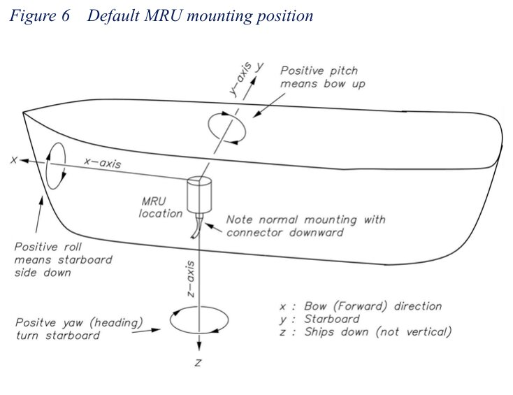
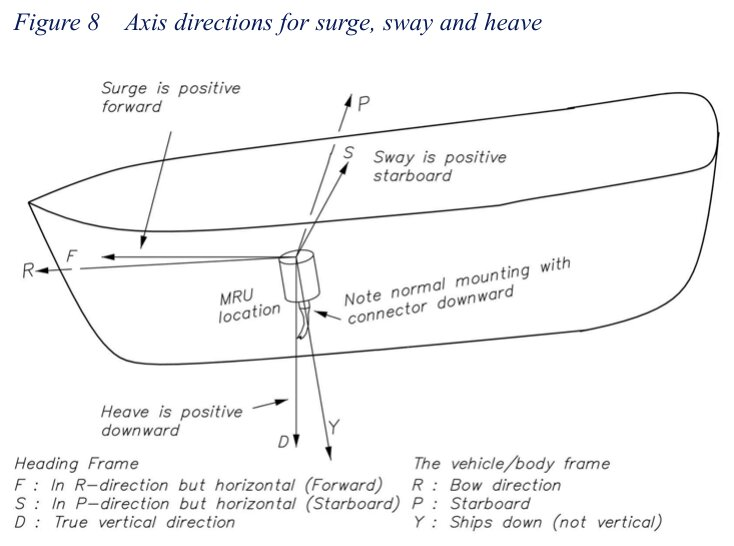

---

## 3. O que é o MRU por dentro

### 3.1 Como ele calcula (373945E p. 23–32)

- É um sistema **strapdown**: os sensores ficam presos à carcaça, sem cardã nem plataforma girando (373945E p. 23).
- **Curto prazo**: os giroscópios dizem a orientação; ela fica guardada numa matriz de rotação 3×3 atualizada a
  cada ciclo de 5 ms (200 Hz) (373945E p. 23, p. 38; 374199E p. 19).
- **Longo prazo**: os acelerômetros enxergam a gravidade. Uma realimentação **bem lenta** (3 a 10 min) puxa a
  vertical estimada para a média da gravidade, para que acelerações rápidas do navio não sejam confundidas com
  inclinação (373945E p. 23, p. 25–27). Em termos de eletrônica: é um filtro complementar com constante de tempo de
  minutos. Por isso a precisão total só vem depois de até 15 min ligado.
- **Heave**: dupla integração da aceleração vertical, com um passa-alta para não derivar. O corte depende do
  **período médio das ondas T0** (1 a 25 s) que o usuário configura. Período longo demais = erro lento; curto demais
  = erro de fase nas ondas longas (373945E p. 23, p. 32).
- O heave é sempre **relativo** (em torno de zero), nunca altitude absoluta (373945E p. 32).
- Giro filtrado com passa-baixa de 2ª ordem a 10 Hz (atraso de grupo até 30 ms); aceleração filtrada a 3 Hz (até
  95 ms) (373945E p. 31–32, p. 39).
- Atraso total típico: 3,5 ms + o tempo de transmissão da mensagem (373945E p. 39; 374199E p. 23).
- O giroscópio é MEMS vibratório (força de Coriolis), sem peças que gastam (373945E p. 51–52).
- A carcaça é cheia de **nitrogênio** e **não pode ser aberta** no campo (373945E p. 42).

### 3.2 Modelos e qual serve para helideque (373945E p. 15–19)

| Modelo | Roll/pitch | Heave (tempo real) | Montagem livre | Observação |
|---|---|---|---|---|
| MRU 5+ | 0,01° | 5 cm | sim | topo de linha, levantamento hidrográfico |
| **MRU 5** (itens 11 e 12) | 0,02° | 5 cm, períodos até 25 s | sim | compensação de guindaste, ecobatímetro, monitoramento (373945E p. 17) |
| **MRU E** | 0,05° | 5 cm | sim | o manual cita **montagem sob o centro do helideque em HMS**, ao ar livre, −25 a +70 °C (373945E p. 17) |
| MRU H | 0,05° | 5 cm | sim | ambiente com muita aceleração horizontal (373945E p. 18) |
| MRU 3 | 0,08° | 5 cm, até 18 s | não (conector para cima ou baixo) | (373945E p. 18) |
| **MRU 2** (item 10) | 0,1° | **não mede** | não | só roll/pitch, faixa ±25° (373945E p. 18; 374716E p. 18) |
| MRU D | 0,35° | não mede | não | (373945E p. 19) |

Ficha do **MRU 5** (374199E p. 18–23): roll/pitch 0,02° RMS, faixa ±180°, giro ±149 °/s, heave ±50 m com 5 cm ou
5 % (o maior), processamento 200 Hz, estabilização máx. 15 min, Ø105 × 140 mm, 2,4 kg, conector Souriau 26 pinos
MIL, alimentação 10–36 V CC (24 V recomendado), máx. 12 W (típico 8 W), IP-66, −5 a +55 °C, EMC e vibração
IEC 60945, MTBF 50 000 h.

**Consequência para o HMS**: o MRU 2 (item 10) não dá heave, então sozinho não atende o HMS (que precisa de
velocidade de arfagem); serve para roll/pitch de posicionamento dinâmico, por exemplo (374716E p. 16).
**[interpretação]** Os dois MRU 5 (itens 11 e 12) é que fariam o papel de sensor de movimento do helideque.

---

## 4. Como o MRU chega

### 4.1 O que vem na caixa (373945E p. 19; 374199E p. 17, p. 104)

- O sensor MRU.
- Cabo de configuração Ethernet de 3 m para PC (MRU-T-015) + fonte de 24 V para esse cabo (MRU-E-P24).
- Cabo Ethernet cruzado de 1 m (MRU-E-CE1).
- **Pendrive** com o software MRC+, os manuais, o arquivo de configuração e o **arquivo de calibração**
  `mruNNNNN.par` (NNNNN = número de série) (373945E p. 21).
- **Caixa de transporte** (MRU-M-SC1).
- Conforme o pedido: suporte (piso MB5, parede MB4 ou protegido MB6), caixa de junção MRU-E-JB3 e cabo MRU-E-CS8.

### 4.2 Certificado de calibração de fábrica (373945E p. 21–22)

Cada unidade é calibrada numa mesa de 2 eixos Acutronic com câmara térmica (precisão melhor que 0,0003°), em várias
taxas e temperaturas, por mínimos quadrados. Depois passa por:

- teste dinâmico de roll/pitch com **duas senoides** de frequências diferentes durante **10 min** (RMS e gráficos);
- ruído estático de ângulos, giro e acelerômetro durante **30 min**;
- fator de escala do giro girando a **±10 °/s e ±30 °/s**;
- fator de escala do acelerômetro inclinando em **passos de 30°**.

O certificado traz modelo, número de série, número do certificado e uma coluna aprovado/reprovado por item.

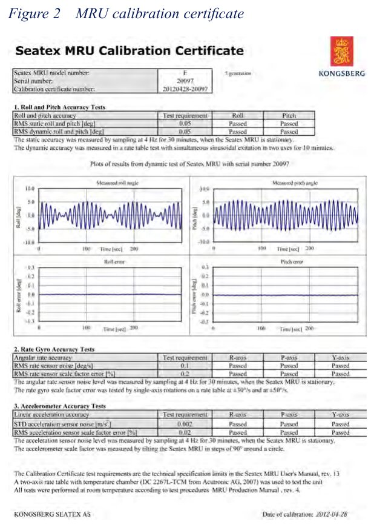

### 4.3 Cuidados no transporte e armazenagem (373945E p. 12–14)

- Manter seco, abrigado, sem choque nem vibração; armazenar entre −25 °C e +70 °C.
- **Guardar a caixa de transporte**: a garantia exige que o MRU volte para reparo nela.
- A garantia cai se: não vier na caixa original, sofrer choque extremo, for aberto, ou receber sobretensão ou ligação
  errada.
- Exportação fora de alguns países exige licença (373945E p. 12).

No vídeo, a unidade reserva está em cima da **caixa de transporte azul da Teledyne**, com etiqueta "FRAGIL" (Vídeo_2
00:08–00:10; Vídeo_3 00:24).

---

## 5. Inspeção de chegada (o print da chefe)

A Imagem_1 é exatamente este procedimento: Apêndice A do manual do usuário, "Arrival check and test"
(373945E p. 48–50). Serve também como bancada de diagnóstico.

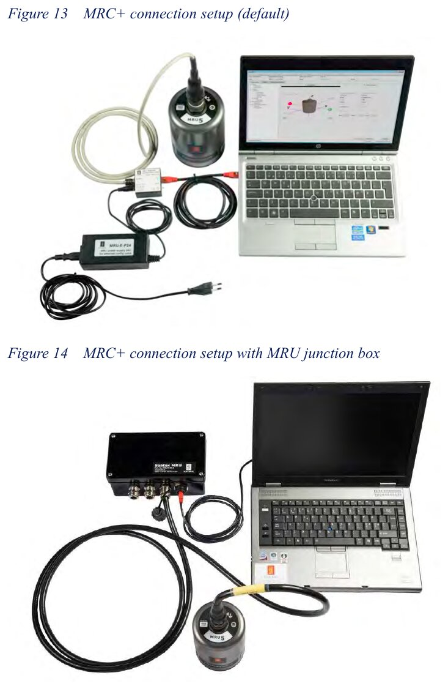

**Material** (373945E p. 48): fonte MRU-E-P24 + cabo de configuração MRU-T-015 (ou caixa de junção MRU-E-JB3 + cabo
MRU-E-CS8), cabo Ethernet, PC com Windows e porta de rede livre, mesa firme.

**Passo a passo** (373945E p. 48–50; ligação de rede em 374199E p. 58–62):

1. Pôr o MRU na mesa com o **conector para cima**.
2. Instalar o MRC+ (`SW\MRC\MRC+setup.exe` no pendrive) (374199E p. 57–58).
3. Ligar PC ↔ caixinha do cabo de configuração ↔ MRU, e a fonte de 24 V na caixinha. O LED do MRU pisca verde e
   azul (374199E p. 59).
4. O MRU vem com IP **192.168.1.20**; pôr o PC em 192.168.1.x (ex.: 192.168.1.10) (374199E p. 59).
5. No MRC+: *Sensor → Connect* (opção *Factory IP*). Se não conectar, apertar o pino da caixinha até a luz azul
   ficar vermelha: volta ao IP de fábrica (374199E p. 62–63).
6. Como o conector está para cima, em *Sensors → MRU → Geometry* pôr ângulos de montagem **180, 0, 0** (de fábrica é
   0, 0, 0 = conector para baixo) (373945E p. 50).
7. Em *Communication Interface → Input/Output → Ethernet #1*: Broadcast, formato **MRU Normal**, intervalo
   **100 ms**, token **78**, variáveis **63 (roll)** e **64 (pitch)** (373945E p. 50).
8. *Configuration → Send to sensor unit*.
9. Aba *Data Presentation*, marcar as variáveis e *Start*: roll e pitch devem **estabilizar em até 10 min** e as
   curvas ficar **verdes** (amarelo = precisão reduzida). Mexer o MRU com cuidado e ver os ângulos mudarem.
   Se tudo isso acontece, a unidade está aceita (373945E p. 50; 374199E p. 88).

**LED do MRU** (374199E p. 24): cada segundo tem 4 fatias — sincronismo de tempo (PPS), vazio, auxílio externo
(rumo/velocidade) e estado (verde = OK). Vermelho piscando a 4 Hz = defeito. Amarelo a cada 4 s = IP de fábrica.

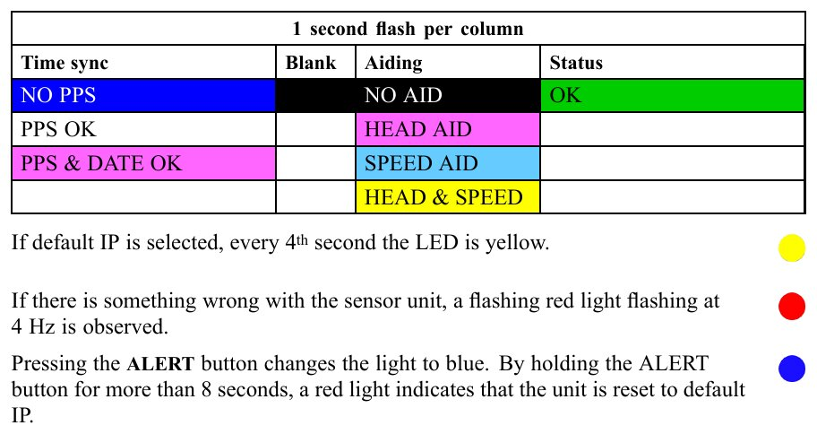

---

## 6. Onde instalar

### 6.1 Regras do fabricante (374199E p. 29)

- Ambiente **interno** e dentro da faixa de temperatura (o MRU E é a exceção, feito para convés aberto — 373945E p. 17).
- **Para heave**: perto do equipamento cujo movimento se quer (para o HMS, o helideque), para evitar erro de
  alinhamento e a torção do casco.
- **Para roll/pitch**: o mais perto possível do CG, baixo e na linha de centro; ou informar o braço até o CG.
  Evitar alto ou no costado, porque o roll é o movimento dominante.
- **Vibração**: fixar direto na estrutura do casco. Evitar anteparas finas que ressoam, bombas e válvulas
  hidráulicas. Sensível a vibração perto de **14 kHz** e de múltiplos de **100 Hz**: menos de 0,5 m/s².
- **Temperatura**: lugar fresco e de variação lenta, longe de máquinas, aquecedores e ar-condicionado.
- **Corrosão**: sem respingo de água do mar.
- Braços de alavanca de até 100 m até o ponto de monitoramento não degradam a posição/velocidade; a aceleração só
  pode ser transportada por poucos metros (374199E p. 36).

### 6.2 O que a norma brasileira exige (N223)

- Os sensores de movimento **devem ficar no piso do helideque**. Se não der, os valores de caturro, balanço,
  arfagem, velocidade de arfagem, SVArf e inclinação **têm que ser corrigidos para a altura e a posição do
  helideque** (N223 p. 41 e p. 101). É exatamente para isso que existe o ponto de monitoramento (MP) com braço de
  alavanca.
- Calibração dos sensores: segundo o fabricante; sem intervalo definido, **a cada 24 meses**, rastreável à RBC/Inmetro
  (N223 p. 101).

### 6.3 O que se vê nos vídeos

- O DMS-25 instalado está **em pé**, preso por **4 parafusos** pela flange da base a uma **chapa de aço** sobre um
  pedestal no piso (Vídeo_1 00:01; Vídeo_2 00:35; Vídeo_3 00:13).
- A sala tem paredes e teto com **manta térmica aluminizada** presa por pinos (Vídeo_2 00:01; Vídeo_3 00:13).
  **[interpretação]** Compartimento isolado termicamente, coerente com a recomendação de temperatura estável.
- Ao lado do pedestal desce um feixe de cabos cinza e mangueiras azuis para dentro de uma base no piso (Vídeo_3
  00:13–00:17).
- Aparece uma pessoa de **macacão laranja com faixas refletivas** (Vídeo_3 00:24–00:26). **[interpretação]** Traje
  típico de embarque: os vídeos parecem gravados a bordo, não no laboratório.


---

## 7. Levantamento dimensional (survey)

Sem medir onde o sensor ficou, a precisão especificada não vale (374199E p. 30).

### 7.1 O sistema de coordenadas do navio (374199E p. 30–31)

- X para a **proa** (paralelo à linha de centro), Y para **boreste**, Z **para baixo**. Mão direita.
- Origem: em geral a baliza 0 na quilha, ou a do relatório de survey. O **CRP** fica no cruzamento popa × linha de
  centro × quilha.
- Plano de referência bem definido (plano médio do convés principal ou das marcas de calado), porque no mar não dá
  para projetar a horizontal a partir da terra.
- A convenção tem que ficar clara para quem mede e para quem usa: é a fonte de erro mais comum.

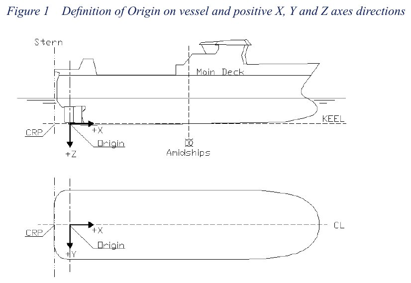

### 7.2 O que medir e com que precisão (374199E p. 32–33)

| Item | Precisão exigida |
|---|---|
| Posição do MRU (centro da cruz na tampa) em relação à origem | < 0,1 m |
| Posição dos pontos de monitoramento (ex.: centro do helideque) | < 0,1 m |
| Posição do CG | < 1 m |
| Desalinhamento em **yaw** entre MRU e navio | **< 0,5°** |
| Desalinhamento em **roll e pitch** | **< 0,1°** |

O roll e pitch de montagem devem ser conferidos contra a própria leitura do MRU depois de configurados (374199E
p. 32).

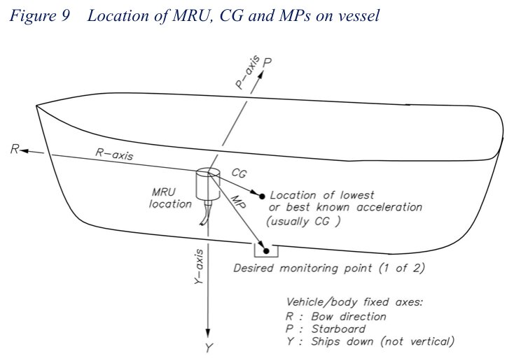

### 7.3 Braços de alavanca (374199E p. 36–38)

- **CG**: vetor do MRU até o CG, nos eixos R, P, Y, precisão melhor que 1 m. Com ele o MRU dá roll/pitch como se
  estivesse no CG.
- **MP1 e MP2**: vetor do MRU até cada ponto, precisão melhor que 0,1 m. Se o ponto se move (lança de guindaste), o
  computador pode mandar o vetor em tempo real com o comando *Set Lever Arm Vector* (374199E p. 37, p. 113).
- **Cuidado com o sinal de Z**: positivo para baixo. Se o ponto está acima do MRU, Z é negativo (374199E p. 38;
  373945E p. 46). Braço longo também amplifica a vibração (374199E p. 38).

---

## 8. Montagem mecânica

### 8.1 Orientação (374199E p. 33–35)

- Padrão: **conector para baixo, seta x para a proa, seta y para boreste, z para baixo**.
- Pode ser montado em qualquer posição: os ângulos entre os eixos do MRU e os do navio vão para o software. **O ajuste
  fino é feito por software, não mecanicamente** (373945E p. 30).
- O MRC+ tem um assistente: primeiro rotações de 90° por eixo, depois os pequenos desvios do suporte (inclinação do
  suporte para boreste, para a popa, e giro horário). Se o desvio passar de 45°, escolher outra rotação principal.
  Evitar x apontando para cima ou para baixo (singularidade de Euler) (374199E p. 34–35, p. 71–73).
- A referência de precisão é a tampa; há furos para **pinos-guia** que ajudam a alinhar (373945E p. 30).

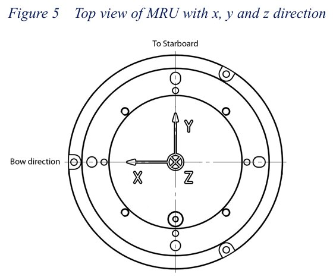

### 8.2 Suporte de piso MB5 (374199E p. 38–40)

1. Local preferido: piso ou mesa de aço.
2. Base com a seta x para a proa, se puder escolher.
3. Furar **3 × M6** na fundação.
4. **Bucha plástica** entre piso e base em cada furo: isola o MRU eletricamente da estrutura (aterramento) e evita
   corrosão galvânica.
5. Bucha, arruela, parafuso M6 e porca autotravante.
6. Placa adaptadora no MRU com **4 × M4** e Loctite 242, setas x/y coincidindo.
7. Encaixar nos pinos-guia da base, setas coincidindo.
8. **3 × M4** com Loctite da placa à base.
9. Caixa de junção ao alcance do cabo de 3 m.

Também há suporte de parede (MB4) e o protegido (MB6), sempre com a abertura para baixo e preso em antepara
longitudinal ou transversal da estrutura (374199E p. 41–46). Na manutenção, **só o MRU sai**; o suporte fica a bordo
(373945E p. 42).

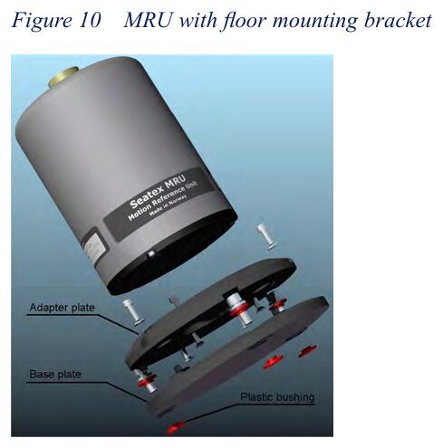
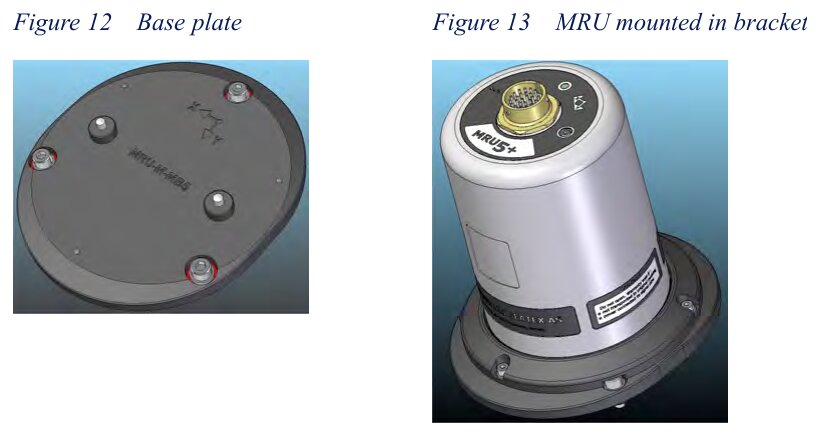

**Pessoal** (374199E p. 28): eletricistas treinados, 1 pessoa, um PC. Sem requisito especial de segurança.

---

## 9. Instalação elétrica

### 9.1 Visão geral

```text
                       cabo MRU-E-CS8 (3 m, 14 pares, blindado)
 ┌───────┐  Souriau 26p ════════════════════════════╗
 │  MRU  │                                          ║
 └───────┘                              ┌───────────╨────────────────────────────────┐
                                        │  CAIXA DE JUNÇÃO MRU-E-JB3 (IP-65)         │
                                        │  P1 lado sensor                            │
                                        │  P2 lado usuário: 24 V, COM1..4, analógicas│──── cabo de navio ──► HMS (RS-422)
                                        │  P3 Ethernet + relé "analógico pronto"     │──── rede (opcional)
                                        │  P4 100–240 V CA (fonte interna → 24 V)    │◄─── rede elétrica (opcional)
                                        │  fusível T2A 250 V · DIP 120 Ω · LEDs      │
                                        └────────────────────────────────────────────┘
```

(374199E p. 20, p. 25–27, p. 46–49; 373945E p. 44)

### 9.2 Alimentação (374199E p. 21, p. 24–25)

- **10 a 36 V CC**, recomendado **24 V**; MRU 5 até 12 W (típico 8 W); MRU 2 até 4,9 W (374716E p. 21).
- Sem bateria: recomenda **nobreak (UPS)**.
- Alimentação **isolada galvanicamente** dos sinais (até 200 V).
- **Fusível externo lento de 2 A** (a caixa de junção já tem).
- **Cuidado**: tensão nos fios de Ethernet ou de dados **queima** o MRU, e isso não é coberto pela garantia. Medir a
  tensão no conector **antes** de ligar o sensor.
- Cabo de navio longo (> 30 m): resistência ida+volta < 10 Ω a 24 V → até 200 m com 0,75 mm² (374199E p. 25).

No vídeo, a unidade em bancada está numa **fonte de bancada em 32,0 V e 0,244 A** (≈ 7,8 W) (Vídeo_2 00:15) e
**32,07 V e 0,245 A** (Vídeo_3 00:34). **[interpretação]** É o DMS-25 sendo alimentado fora do pedestal; a tensão está
dentro do que um MRU de mercado aceita, mas acima do que o nosso aceita (seção 14).

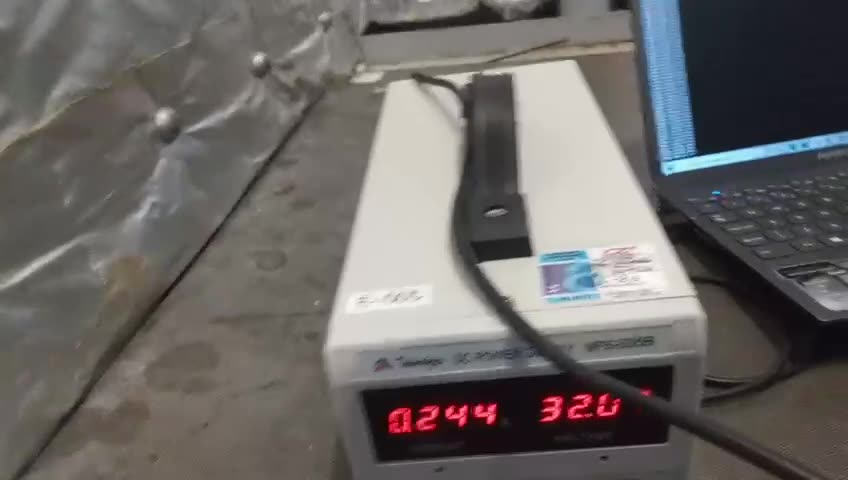
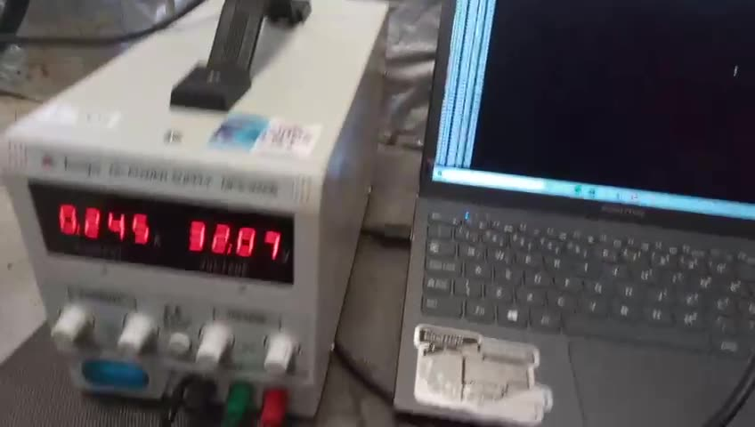

### 9.3 Sinais no conector (374199E p. 25–27)

| Sinal | Função |
|---|---|
| PWR+ / PWR− | 24 V / 0 V |
| COM1 OUT A/B, IN A/B | **RS-422 bidirecional** — a saída típica para o HMS |
| COM2 IN/OUT | RS-232 bidirecional (na caixa de junção também vira RS-422) |
| COM3, COM4 | só entrada, RS-232 ou RS-422 (rumo, velocidade, hora) |
| RJ_1/2/3/6 | Ethernet 10/100 (UDP: 3 portas de saída e 1 de entrada) |
| XIN | entrada de **1PPS** (nível RS-232 ou ≥ 2,5 V) |
| XOUT | saída "MRU pronto" (0/5 V) |
| ALERT | botão de alerta/reset de IP |
| CGND / GGND | terra de comunicação / terra do MRU |

Todas as linhas de comunicação compartilham o CGND e são isoladas da alimentação (374199E p. 27).

**Pegadinha do RS-422** (374199E p. 26): pela IEC 61162-1, repouso/"1" é **A negativo em relação a B**. Isso é
**invertido** em relação ao que muitos UARTs e transceptores entregam; trocar A e B é o erro clássico de campo.

### 9.4 Ligação na caixa de junção (374199E p. 46–50)

1. Cabo do MRU no sensor e na caixa; **malha encostada no prensa-cabo** (aterramento).
2. Cada fio no borne P1.
3. Cabo de navio e de energia por outro prensa-cabo, malha aterrada.
4. **Malha aterrada só numa ponta** (aberta na outra). Prensa-cabos sem uso vedados com fita autofusão.
5. A caixa aterra pelos parafusos de fixação; se a base não for aterrada, puxar um fio de um parafuso até a massa.
6. Fios do usuário no P2.
7. **Chaves DIP** de COM3/COM4: em RS-422 ligam o **terminador de 120 Ω** (importa em cabo longo).
8. Opcional: relé de "analógico pronto" (24 V em RL_C, retorno em RL_NO) no P3.
9. Opcional: 100–240 V CA no P4 se não houver 24 V CC (pode ter os dois ao mesmo tempo).
10. Energizar e conferir LEDs: MRU PWR verde (sensor alimentado), AC PWR vermelho (CA presente), COM piscando
    vermelho (dados saindo no COM1), MRU verde (sensor rodando), DAC amarelo (analógica em uso).

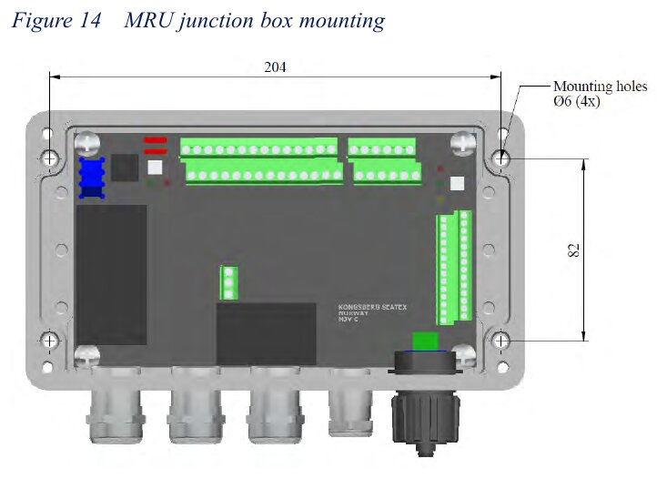

---

## 10. Alinhamento e configuração

### 10.1 Alinhar os eixos ao navio (374199E p. 55–56)

Depois de montado, o desalinhamento entre os eixos do MRU e os do navio precisa ser **medido e informado**, em
especial o **yaw, com erro menor que 0,5°**. Exemplo do manual: 1° de erro de yaw dá **±0,09° de erro de roll** com o
navio caturrando ±5°, porque parte do pitch "vaza" para o roll. A referência pode ser o casco, o ecobatímetro ou o
USBL. Sem isso a precisão cai (aviso em 374199E p. 55; também 373945E p. 45).

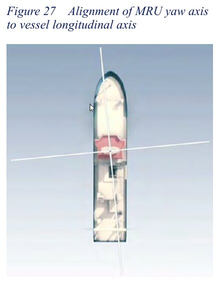
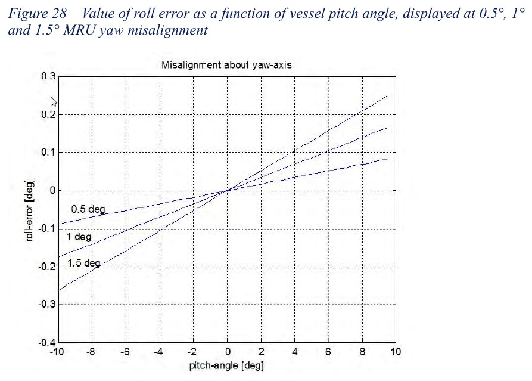

### 10.2 O que se configura no MRC+ (374199E p. 57–88)

O MRC+ roda no Windows e fala com o MRU **só por Ethernet**. Serve para configurar, ver estado, atualizar software,
plotar e gravar dados (374199E p. 57).

| Aba / menu | O que se ajusta | Fonte |
|---|---|---|
| Sensor | conectar, reiniciar (re-estabiliza em ~15 min), enviar arquivo de calibração, sincronizar relógio, atualizar software | 374199E p. 64 |
| Vessel → Geometry | forma do navio, dimensões, posição da origem (da popa, da linha de centro, da quilha), posição do CG | 374199E p. 66–67 |
| Vessel → Description | nome, armador, MMSI, IMO | 374199E p. 70 |
| Sensors → MRU → Geometry | posição do MRU a partir da origem; braço até o CG (máx. 150 m); **ângulos de montagem** roll/pitch/yaw ou assistente | 374199E p. 70–73 |
| Sensors → MRU → Heave config | modo do filtro, **período T0** (1–25 s), **amortecimento** (0,3–1,3; normalmente 0,7) | 374199E p. 73–74 |
| Sensors → MRU → Special | idade do rumo externo, **latitude** (modelo de gravidade, ±5° basta), filtro de surge/sway, heave integrado | 374199E p. 75 |
| GNSS geometry | posição da antena | 374199E p. 76 |
| Monitoring points | até **2 MPs** (ex.: centro do helideque), posição a partir da origem | 374199E p. 77–79 |
| Communication → Network | IP, máscara, gateway (vale após reiniciar) | 374199E p. 80 |
| Communication → Input/Output | por porta: baud (1200–115200), paridade; UDP broadcast/unicast/multicast + porta; **formato**, **local** (MRU, CG, MP1, MP2), **intervalo** (múltiplo de 5 ms; 0 = só sob pedido), token, até **24 variáveis** | 374199E p. 80–85 |
| Analog output | 4 canais ±10 V pela caixa de junção, `V = ganho × (variável + offset)` | 374199E p. 85 |
| Status | versão, série, calibração, nº de partidas, horas de uso; estado de velocidade/rumo/tempo externos; dados "Normal/Reduced/Not available" | 374199E p. 86–87 |
| Data presentation | até 6 gráficos; **Log to file** em ASCII (`*.tsa`) com cabeçalho | 374199E p. 88 |

Banda necessária (374199E p. 83): no formato MRU Normal, ~40 bits por variável + 40 bits por mensagem. Ex.: 4
variáveis a 20 Hz → `(4·40 + 40)·20 = 4000 bit/s`. O manual pede **não exagerar no baud** em linha longa.

### 10.3 Escolhendo o filtro de heave (373945E p. 33–36; 374199E p. 73–74)

- **Hydrographic survey**: amplitude e **fase** certas em tempo real. É o indicado quando o heave alimenta um sistema em
  tempo real (ecobatímetro, guindaste).
- **Automatic**: estima o período sozinho; usa a estrutura do Hydrographic. Para mar variável ou período desconhecido.
- **General purpose**: só amplitude certa (boia oceanográfica).
- Tempo de acomodação ≈ **10 × T0** depois de ligar ou de uma curva.
- Recomendações sem ajuda externa (373945E p. 34): **T0 = 5 s** (ondas curtas, rios, portos; acomoda em ~50 s),
  **T0 = 10 s** (padrão, cobre a maioria), **T0 = 20 s** (oceano aberto, mar de popa, swell longo).
- Damping 0,7 (373945E p. 36). A variável 129 mostra o período estimado, útil para escolher T0.
- O período pode ser estimado à mão cronometrando duas cristas (374199E p. 74).
- Também existe heave **atrasado** (PFreeHeave, 132 s de atraso, períodos até 50 s, precisa de ZDA + PPS) para
  pós-processamento; **não serve para HMS**, que é tempo real (373945E p. 37–38).

---

## 11. Como os dados saem do MRU e chegam ao HMS

### 11.1 Interfaces (374199E p. 23, p. 107)

- Serial: 1200 a 115200 baud, 1 start, 8 dados, paridade programável, 1 stop. Padrão de fábrica **9600 8N1** em COM1 e
  COM2 (374199E p. 131).
- Ethernet UDP: cada telegrama é uma mensagem.
- Até 24 variáveis, até 200 Hz, **cíclico** (o MRU manda sozinho) ou **sob pedido** (o host pergunta).
- Cada porta tem o **seu** formato: dá para mandar TSS1 no RS-422 para o HMS e outra coisa na rede ao mesmo tempo.

### 11.2 Formatos de saída (374199E p. 23, p. 107, p. 115–127)

| Formato | Tipo | Conteúdo | Uso típico |
|---|---|---|---|
| MRU Normal | binário | até 24 variáveis escolhidas, float IEEE big-endian, checksum | integração dedicada |
| NMEA proprietário `$PSXN,10` | ASCII | até 6 variáveis (até 16 estourando 80 caracteres) | integração em ASCII |
| Sounder | ASCII fixo | igual ao TSS1, só muda o caractere de estado | ecobatímetros Simrad |
| **TSS1** | ASCII fixo, 27 caracteres | acel. lateral e vertical, **heave, roll, pitch, estado** | ecobatímetros, HMS, compatibilidade com sensores TSS |
| Simrad EM3000 | binário | roll, pitch, heave, rumo | multifeixe Kongsberg |
| ATLAS | binário | roll, pitch, heave, estado | Atlas Fansweep |
| Seapath Binary 23/26 | binário | tempo, atitude, taxas, heave (26 tem heave atrasado) | EM710/EM2040 |
| PFreeHeave | binário | heave atrasado | pós-processamento |
| RDI `$PRDID` | ASCII | pitch, roll, rumo | ADCP |

**[externo]** O nome "TSS1" vem da própria TSS (hoje Teledyne TSS), fabricante do DMS-25 dos vídeos; a Kongsberg o
implementa por compatibilidade. **[interpretação]** É o formato mais provável de o HMS daquela plataforma estar lendo,
porque é o que os dois fabricantes do material falam. **Confirmar com a Katia** (seção 15).

### 11.3 TSS1 em detalhe (374199E p. 121–122)

```text
:aabbbb shhhhxsrrrr spppp<CR><LF>
 aa    = aceleração lateral (sway), hexa, unidade 0,03835 m/s²
 bbbb  = aceleração vertical, hexa, unidade 0,000625 m/s²
 shhhh = heave em cm, POSITIVO PARA CIMA, sinal ' ' ou '-'
 x     = estado: U/u sem auxílio, G/g com velocidade, H/h com rumo, F/f com os dois (maiúscula = estável, minúscula = instável)
 srrrr = roll em centésimos de grau
 spppp = pitch em centésimos de grau
```

- **Atenção ao heave**: no TSS1 é positivo **para cima**; nas variáveis do MRU é positivo **para baixo**.
- **Atenção ao roll**: no TSS1 não é o roll de Euler, é `roll_TSS1 = arcsin[sin(roll_Euler) · cos(pitch_Euler)]`
  (374199E p. 121). Com pitch pequeno quase não muda.
- A letra minúscula (`u`) indica dado **instável**: na partida, nos ~5 min de alinhamento (374199E p. 122).

Exemplo do manual, decodificado (374199E p. 122):

```text
:1a36b0 -0254U-0087 0378
 1a    → 26 × 0,03835      = 1,0 m/s²   (lateral)
 36b0  → 14000 × 0,000625  = 8,75 m/s²  (vertical)
 -0254 → heave = −2,54 m   (para cima negativo → 2,54 m ABAIXO da média)
 U     → sem auxílio externo, dado estável
 -0087 → roll  = −0,87°    (bombordo desce)
  0378 → pitch = +3,78°    (proa sobe)
```

Inclinação que o HMS calcularia com esse par: `arccos(cos 0,87° · cos 3,78°) ≈ 3,9°` (bate com a tabela 2 da
N223 p. 105, entre B = 1,0°/C = 3,5° → 3,6° e C = 4,0° → 4,1°).

### 11.4 NMEA proprietário `$PSXN` (374199E p. 117–118)

```text
$PSXN,10,019,5.100e-2,-5.100e-2,1.234e+0,771598427,,*61
       │  │      │        │         │        │
       │  │      roll     pitch     heave    data (s desde 1970)
       │  token escolhido pelo usuário
       10 = dado estável (11 = instável)
```

- Valores em **unidades SI** (rad, m, m/s), em notação científica.
- O usuário escolhe quais variáveis vão em cada campo (até 6).

### 11.5 MRU Normal, binário (374199E p. 115–117)

```text
<'q'><len><token><dados...><checksum>
'q' vira 'Q' quando o dado está instável (partida, movimento brusco)
Exemplo: roll(63), pitch(64), heave(226), token 47, a cada 100 ms:
71 0d 2f | 3d 50 e5 60 | bd 50 e5 60 | 3f 9d f3 b6 | cb
          roll 0,051 rad  pitch −0,051   heave 1,234 m   checksum = soma mod 256
```

Comandos ao MRU no mesmo protocolo, cabeçalho `'C'`: pedir amostra (1), suspender transmissão (2), informações (7),
estado (9), velocidade externa (12), rumo externo (13), **braço de alavanca** (15/16), relógio (17), trocar as
variáveis de saída (19/20) (374199E p. 109–115). No ASCII, `$PSXN,?` pede uma amostra (374199E p. 129).
Na partida o MRU manda uma "mensagem de boas-vindas" com versão e série; em modo anormal manda a cada segundo um
texto com o código do erro, e o LED pisca vermelho a 4 Hz (374199E p. 130).

### 11.6 Variáveis que interessam ao HMS (374199E p. 137–142)

| Nº | Nome | Unidade | Para quê |
|---|---|---|---|
| 63 / 64 / 65 | Roll / Pitch / Yaw | rad | balanço e caturro |
| 326 / 376 | PosMp1_D / PosMp2_D | m | **heave no ponto de monitoramento** (ex.: helideque), para baixo |
| 314 / 364 | VelMp1_D / VelMp2_D | m/s | **velocidade de arfagem** no ponto |
| 305 / 355 | AccMp1_Df / AccMp2_Df | m/s² | aceleração vertical filtrada no ponto |
| 224–226 | PosMru_F/S/D | m | surge, sway, heave no próprio MRU |
| 129 / 159 | AutomaticPeriod / HeavePeriod | s | período de onda (ajuda a escolher T0) |
| 173 | Status | bits | estado interno (bit 15 roll/pitch não confiável, bit 13 heave não confiável…) (374199E p. 143) |

### 11.7 Entradas que o MRU aceita (374199E p. 131–136)

- **Rumo** da giro: `$--HDT` / `$--HDM` ou comando 13; de 0,25 a 10 Hz (ideal 2 Hz); sem dado por 3 s = desliga o
  auxílio.
- **Velocidade**: `$--VTG`, `$--VHW`, `$--VBW` ou comando 12; tem que estar no CG.
- **Hora**: `$--ZDA` + **1PPS** no XIN (borda de descida).
- **Altura** RTK: `$--GGA` a 1 Hz com qualidade 4 (só para o heave integrado).

Servem para melhorar roll/pitch em curvas e acelerações (navio navegando). **[interpretação]** Numa plataforma ou
FPSO ancorada pesam menos.

### 11.8 O que o HMS faz com o fluxo (N223)

O HMS fica na estação de rádio (ETEX). Ele mostra **vento** (direção, intensidade, rajadas), **temperatura** e
**movimentos do helideque em tempo real**, **grava** os dados e dá **alarmes** (N223 p. 101).

```text
MRU (200 Hz por dentro)
  │  uma sentença a cada N ms (ex.: TSS1 a 10 Hz em RS-422)
  ▼
HMS
  1. lê, confere checksum/estado, descarta o instável
  2. converte (cm → m, sinal do heave, roll TSS1 → Euler)
  3. leva ao centro do helideque, se o MRU não estiver lá (ou o MRU já entrega no MP)
  4. guarda os últimos 20 min
  5. calcula: máx. |B| e |C|, Inc = arccos(cos B·cos C), Arf (maior meia oscilação),
              VArf (velocidade média nela), SVArf = 2 × RMS(velocidade vertical)
  6. compara com a Tabela 1 (classe do helideque × categoria do helicóptero × dia/noite)
  7. luz VERDE ou VERMELHA; tela; gravação
  8. o radioperador (RPM) informa ao piloto por rádio
```

(N223 p. 11–12 definições; p. 74 o que o RPM informa; p. 101–106 limites e procedimento)

Limites de movimento (N223 p. 103, Tabela 1, valores máximos dos últimos 20 min):

| Helicóptero | Período | Classe 1 (SS, FPSO…) B/C · Inc · SVArf · Arf | Classe 2 (popa/meia-nau) | Classe 3 (proa/superestrutura) |
|---|---|---|---|---|
| Categoria A (AS332, EC225, S-92, AW189…) | dia | ±3° · 3,5° · 1,3 m/s · 5,0 m | ±2° · 2,5° · 1,0 · 3,0 | ±2° · 2,5° · 1,0 · 3,0 |
| | noite | ±3° · 3,5° · 1,0 · 4,0 | ±2° · 2,5° · 0,5 · 1,5 | proibido |
| Categoria B (AW139, S76, EC135…) | dia | ±4° · 4,5° · 1,3 · 5,0 | ±3° · 3,5° · 1,0 · 3,0 | ±3° · 3,5° · 1,0 · 3,0 |
| | noite | ±4° · 4,5° · 1,0 · 4,0 | ±2° · 2,5° · 0,5 · 1,5 | proibido |

- O limite de **arfagem (Arf)** só vale quando não há VArf/SVArf disponível (N223 p. 102).
- Passou de um limite: luz vermelha, o RPM fecha o helideque; nenhum pouso (N223 p. 102).
- Sem HMS: navio com DP usa o movimento do sistema DP; os outros, inclinômetros mecânicos por ~2 min (sem velocidade de
  arfagem); sem nada disso, helideque fechado (N223 p. 106).
- O operador do HMS precisa informar a **classe do helideque** e a **categoria da aeronave** (N223 p. 106).

Exemplo numérico de SVArf: heave senoidal de **0,5 m** de amplitude e **10 s** de período. A velocidade tem amplitude
`2π·0,5/10 = 0,314 m/s`, RMS `0,314/√2 = 0,222 m/s`, então **SVArf = 2 × 0,222 = 0,44 m/s**: abaixo de 1,0 m/s
(classe 2, dia). O mesmo mar com período de 5 s dá 0,89 m/s, quase no limite — por isso o **período** importa tanto
quanto a altura.

### 11.9 Como "extrair dados" na prática

1. **Pelo HMS**: ele já grava; a norma exige guardar os registros (N223 p. 106).
2. **Pelo MRC+**: aba *Data presentation* → *Log to file*, arquivo ASCII `.tsa` com as variáveis em colunas
   (374199E p. 88). Só pela Ethernet; o que sai nas COM não aparece no MRC+.
3. **Escutando a linha serial**: um PC com conversor RS-422 e um terminal, em paralelo ao HMS. Foi o que se fez nos
   vídeos (seção 11.10). Uma saída RS-422 aguenta alguns receptores na mesma linha (o nosso
   `Documents/Protocol/nmea.pdf` fala em até 3 ouvintes por transmissor no NMEA 0183).

### 11.10 O que os vídeos mostram

| Tempo | O que aparece |
|---|---|
| Vídeo_1 00:00–00:02 | DMS-25 instalado: rótulo azul "TELEDYNE TSS · DMS-25 · Depth Rating 3000 m", seta **BOW** (proa), "Warning! Contains a sensitive accelerometer", "Caution: This sensor's default configuration is horizontal". Cabo verde no conector do topo. |
| Vídeo_2 00:00–00:02 | Etiqueta presa no cabo: "MEASURE OFFSHORE · E-401/22 · CALIBRAÇÃO 21/03/2022 · IDENTIFICAÇÃO 043804 · PRÓXIMA 365 DIAS". |
| Vídeo_2 00:03 | Topo do DMS-25 instalado: conector circular com rosca de bronze e capa preta; plaquinhas metálicas com seta na tampa. |
| Vídeo_2 00:05 | "SERIAL NUMBER: 043804" — o mesmo número da etiqueta. |
| Vídeo_2 00:08–00:10 | Segundo DMS-25, em cima da caixa de transporte, com adesivo "measure OFFSHORE" sobre o rótulo e seta de proa. |
| Vídeo_2 00:11–00:15 | Fonte de bancada CC em **32,0 V · 0,244 A**, notebook no chão. |
| Vídeo_2 00:19–00:24 | Notebook (Windows) com um terminal rolando linhas de números em colunas fixas. |
| Vídeo_2 00:31–00:35 | Unidade instalada e a base aparafusada no pedestal. |
| Vídeo_3 00:00–00:08 | Mesmo terminal rolando dados. |
| Vídeo_3 00:10–00:17 | As duas unidades lado a lado: a da caixa e a do pedestal. |
| Vídeo_3 00:24–00:26 | Pessoa de macacão laranja ao fundo. |
| Vídeo_3 00:34 | Fonte em **32,07 V · 0,245 A**. |

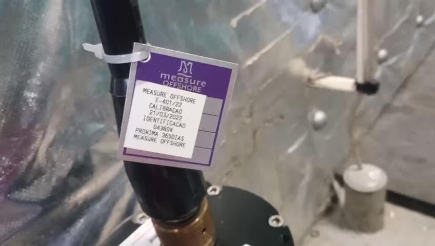


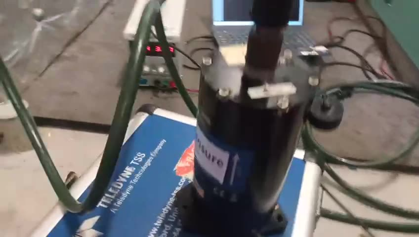
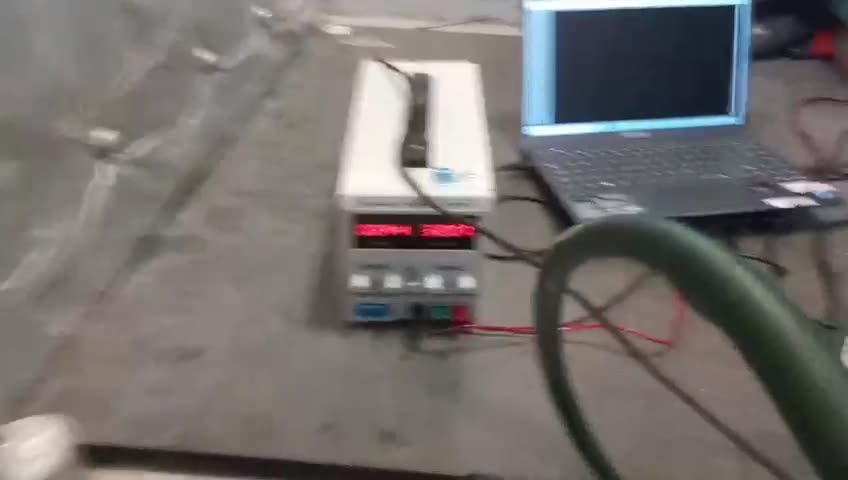
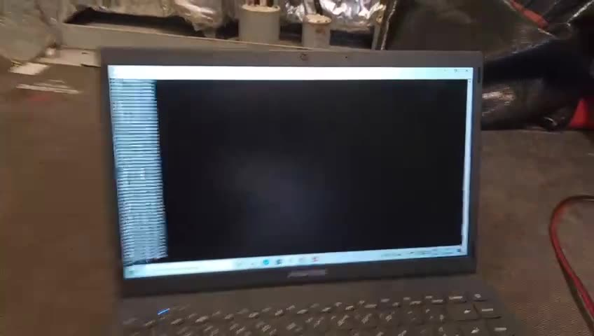


**[interpretação]** O conjunto sugere uma **verificação ou troca de unidade a bordo**: uma unidade calibrada pela
Measure (etiqueta anual, "próxima 365 dias") é ligada fora do pedestal, alimentada pela fonte de bancada, e o fluxo
dela é conferido num terminal serial ao lado da que está em operação. Os números na tela do notebook não são legíveis
na resolução do vídeo (848 × 480); o desenho das linhas — blocos de largura fixa separados por espaços — é compatível
com TSS1, mas **não dá para afirmar**. Não há fala em nenhum vídeo: o Vídeo_3 tem só ruído de fundo.

**Observação**: a calibração **anual** da Measure é mais frequente que a do fabricante (Kongsberg recomenda 2 a 4
anos conforme o modelo, 373945E p. 43) e que o padrão da norma (24 meses, N223 p. 101).

---

## 12. Operação e manutenção a bordo

### 12.1 Ligar, operar, desligar (373945E p. 40–41)

1. Ligar: o MRU parte sozinho e fica operando enquanto houver energia.
2. Até **15 min** para precisão total: autoteste + alinhamento inicial. O estado passa de "reduced accuracy" para
   "normal" nas linhas de comunicação.
3. **Deixar sempre ligado** (não há peças que gastam).
4. Antes da operação, conferir e ajustar o heave (período e amortecimento) para o mar do dia, ou usar o modo
   automático.
5. Desligar = cortar a energia; desliga de forma controlada e guarda a configuração.

### 12.2 Manutenção (373945E p. 42–46)

- Sem manutenção de campo além de atualizar software e configuração. Abrir a carcaça = dano permanente (373945E p. 42–43).
- **Atualização de software** pelo MRC+, sem abrir (373945E p. 42).
- **Recalibração** recomendada (373945E p. 43): MRU 2 e H a cada 4 anos; E e D a cada 3; 5+, 5 e 3 a cada 2. Há uma
  tabela de quanto a precisão piora se passar do prazo (MRU 5: 0,02° em 2 anos, 0,09° em 6).
- **Reparo**: volta só o MRU, na caixa original; o suporte fica a bordo (373945E p. 42).
- **Unidade reserva** (373945E p. 44): no MRC+, *Configuration → Save* grava a configuração da unidade que sai num
  arquivo; na reserva, *Open* + *Send to sensor unit*; montar na mesma orientação. Sem o arquivo, refazer tudo pela
  seção de configuração.
- **Caixa de junção** (373945E p. 44): fusível T2A 250 V 5 × 20 mm; fios soltos; LED MRU PWR verde.
- **Diagnóstico** (373945E p. 45–46):
  - "Abnormal" em vermelho no MRC+: nenhum dado sai; reiniciar.
  - Roll/pitch ruins: seta x desalinhada com o navio (1° já piora em mar forte) ou calibração vencida.
  - Erro ligado ao pitch: ângulo de montagem em z; ligado ao roll: braço de alavanca, principalmente o z.
  - Heave oscilando: modo/período errado; sinal do z do MP (positivo para baixo).

---

## 13. Procedimento completo, em ordem

| # | Etapa | Quem | Referência |
|---|---|---|---|
| 1 | Receber na caixa original, conferir kit e certificado | logística / técnico | 373945E p. 13–14, 19, 21 |
| 2 | Inspeção de chegada com PC + MRC+ (ângulos 180,0,0; vars 63/64; estabiliza em 10 min) | técnico | 373945E p. 48–50; Imagem_1 |
| 3 | Escolher o local (perto do helideque ou corrigido para ele; vibração; temperatura; respingo) | engenharia | 374199E p. 29; N223 p. 41, 101 |
| 4 | Survey: origem, posição do MRU (< 0,1 m), do centro do helideque (< 0,1 m), do CG (< 1 m) | survey | 374199E p. 30–33 |
| 5 | Fixar suporte (buchas isolantes, Loctite, pinos-guia), MRU com seta x para a proa | eletricista | 374199E p. 38–45 |
| 6 | Cabo MRU → caixa de junção → cabo de navio → HMS; malha numa ponta; terminador; fusível; medir a tensão antes de conectar | eletricista | 374199E p. 25–27, 46–50 |
| 7 | Energizar e conferir LEDs | eletricista | 374199E p. 24, 49 |
| 8 | MRC+: navio, origem, CG, posição do MRU, **ângulos de montagem** (yaw < 0,5°, roll/pitch < 0,1°), MP = centro do helideque | técnico | 374199E p. 66–79 |
| 9 | Heave: modo, T0, damping; latitude | técnico | 374199E p. 73–75; 373945E p. 33–36 |
| 10 | Porta do HMS: formato (ex.: TSS1), baud, intervalo, local = MP do helideque | técnico + fornecedor do HMS | 374199E p. 80–85 |
| 11 | Enviar configuração, **salvar arquivo** de configuração, reiniciar, esperar 15 min | técnico | 374199E p. 64; 373945E p. 40, 44 |
| 12 | No HMS: conferir leitura, sinais (levantar proa → pitch +; boreste desce → roll +), classe do helideque e categoria da aeronave | técnico + RPM | 374199E p. 34; N223 p. 106 |
| 13 | Operação contínua; recalibração periódica; troca pela reserva com o arquivo de configuração | operação / Measure | 373945E p. 42–44; N223 p. 101 |

---

## 14. O nosso MRU hoje × o processo da Katia

### 14.1 O que o nosso MRU já é (firmware v1.0.8)

- ESP32-S3 lendo um IMU Kernel-120 a 200 Hz; filtros, correção, Kalman, heave e braço de alavanca embarcados
  (`Hardware/Embedded/Main/README.md`).
- Saídas: **RS-422, RS-232 e USB**, uma por vez; protocolos **JSON**, **LIST** e um NMEA de 4 campos
  `$GPPASHR,pitch,roll,yaw,heave*CS` (`Hardware/Embedded/Main/objects/telemetry/streamer/index.h:120`).
- Campos no JSON/LIST: tempo, temperatura, pitch, roll, yaw, ax, ay, az, wx, wy, wz, **heave** e **heave_rate**,
  heave positivo para baixo, no ponto `LEVER_POINT`.
- Configuração persistente por comandos serial (`CF:`, `CS:`), calibração e parâmetros enviados pela serial sem
  recompilar (`CL:` + `$calibration_save!`), `$status!`, atualização de firmware pela serial.
- 4 posições de montagem por preset de 90° (`$align:N!`), sempre com X do Kernel para boreste.
- Calibração individual em mesa própria, com certificado (critérios: roll/pitch estático ≤ 0,20° e dinâmico ≤ 0,50°).
- Datasheet (`Documents/Datasheet/index.html`): 16–24 V CC (máx. absoluto 29 V), conector circular de 8 vias,
  IP66, Ø101,6 × 126 mm, 451,6 g, 4 × M5, partida em 3 min, padrão 9600 baud.
- O app MRU Monitor já tem uma tela **HMS** com os limites da NORMAM-223, janela de 20 min e SHR
  (`Monitor/src/utils/motion.js`).

### 14.2 Comparação item a item

| Requisito do processo | Referência de mercado | Nosso MRU | Situação |
|---|---|---|---|
| Roll, pitch, heave e velocidade de arfagem no ponto do helideque | MP1/MP2 (374199E p. 37, 141) | heave + heave_rate em `LEVER_POINT` | **OK** |
| Saída RS-422 | COM1 (374199E p. 23) | UART2 RS-422 | **OK** (conferir polaridade A/B, 374199E p. 26) |
| Formato que o HMS existente lê | TSS1 / `$PSXN` / binário (374199E p. 115–122) | só `$GPPASHR` próprio, JSON, LIST | **FALTA** |
| Sinal de dado inválido/instável | `u`, `$PSXN,11`, `'Q'`, status (374199E p. 116–122) | nenhum no stream | **FALTA** |
| Alimentação de bordo | 10–36 V (374199E p. 21); vídeo em 32 V (Vídeo_2 00:15) | 16–24 V, máx. 29 V | **FALTA** — 32 V queimaria |
| Fusível e isolação galvânica | 2 A lento; isolado 200 V (374199E p. 25) | não especificado | **A VERIFICAR** |
| Heave em ondas longas | T0 1–25 s, padrão 10 s, 20 s em oceano (373945E p. 34) | `HEAVE_PERIOD = 1 s` → só passa até ~10 s (`objects/processing/heave/config.h:5`) | **PARCIAL** — dá para mudar por `CL:`, falta validar com período longo |
| Braço do centro de giro | CG lever arm (374199E p. 37) | `KALMAN_LEVER = [2,98; −2,02; 0,10] m` herdado do pêndulo (`objects/processing/attitude/kalman/config.h:15`) | **PARCIAL** — tem que ser zerado/medido na instalação |
| Ajuste fino de montagem (roll/pitch < 0,1°, yaw < 0,5°) | ângulos livres + assistente (374199E p. 33–35, 71–73) | só presets de 90° | **FALTA** |
| Configuração da instalação separada da calibração da unidade | arquivo de configuração para a reserva (373945E p. 44) | `LEVER_POINT` e `HEAVE_PERIOD` ficam no bloco de calibração (`objects/processing/calibration/index.h:72-75`) | **PARCIAL** |
| Saídas simultâneas com formatos próprios | COM1, COM2, 5 UDP, cada um com o seu (374199E p. 114) | uma porta por vez | **FALTA** |
| Porta de saída imune a ruído | — | 4 bytes de lixo em outra entrada mudam o destino do stream (`objects/telemetry/serial/index.h:89-110`) | **FALTA** (risco real em campo) |
| Ethernet | UDP (374199E p. 23, 80) | não tem | desejável |
| Entradas de rumo, velocidade, hora | HDT/HDM, VTG/VHW/VBW, ZDA + 1PPS (374199E p. 131–135) | não tem | desejável |
| Conector e cabo | Souriau 26p + MRU-E-CS8 + caixa de junção (374199E p. 19, 25) | circular 8 vias | **PARCIAL** — precisa de cabo/caixa adaptadora para o cabo de navio existente |
| Fixação no pedestal existente | base com pinos-guia (374199E p. 39–40); DMS-25 por flange com 4 parafusos (Vídeo_2 00:35) | base 101,6 mm, 4 × M5 | **PARCIAL** — falta placa adaptadora e referência de alinhamento |
| Estado visível (LED, mensagem de partida/erro) | códigos de LED, boas-vindas, modo anormal (374199E p. 24, 130) | 2 LEDs internos, `$status!` sob pedido | **PARCIAL** |
| Ensaios do certificado | dinâmico 10 min com 2 senos, estático 30 min, escala de giro ±10/±30 °/s, acelerômetro em passos de 30° (373945E p. 21) | ensaio em mesa de 1 eixo por vez, pitch/roll a 0,3 Hz | **PARCIAL** |
| Precisão | MRU E 0,05°, MRU 5 0,02° (373945E p. 15) | aceita até 0,20° estático / 0,50° dinâmico | **PARCIAL** — para 1/10 do menor limite da norma (±1°) seria 0,1° |
| Rastreabilidade da calibração | 24 meses, RBC/Inmetro (N223 p. 101) | certificado próprio | **A VERIFICAR** |
| EMC e vibração | IEC 60945 (374199E p. 22) | não ensaiado | **FALTA** |
| Partida | máx. 15 min (373945E p. 40) | 3 min | **OK** |
| Software de configuração | MRC+ por Ethernet (374199E p. 57) | MRU Monitor pela serial (Produção, Dispositivo) | **OK** (equivalente) |

### 14.3 O que falta, por prioridade

**P0 — sem isto não substitui o sensor atual no HMS**

1. **Falar o formato do HMS.** Implementar no `Streamer` um protocolo **TSS1** (heave em cm positivo para cima, roll
   `arcsin(sin φ cos θ)`, caractere de estado, 27 caracteres) e, se a Katia confirmar, o `$PSXN,10/11` com variáveis
   escolhidas. O `$GPPASHR` atual não é o `$PASHR` do mercado: **[externo]** o `$PASHR` documentado no gpsd (a
   referência do nosso `Documents/Protocol/nmea.pdf`) traz hora, rumo, roll, pitch, heave, precisões e flags, em
   outra ordem; um HMS que espera esse layout leria os nossos campos trocados. O datasheet promete "PASHR lida pelos HMS
   de mercado": precisa ser verdade antes de ir a bordo.
2. **Sinalizar dado ruim.** Durante a partida, com o Kernel sem responder, ou com pacote atrasado, o stream tem que
   dizer (letra minúscula no TSS1, `$PSXN,11`). Hoje o HMS receberia números aparentemente válidos.
3. **Alimentação.** Aceitar a faixa de bordo com margem (o vídeo mostra 32 V; a Kongsberg aceita 10–36 V), com
   proteção contra inversão e surto e fusível. Hoje o datasheet limita a 29 V.
4. **Porta de saída fixa.** O stream do HMS não pode migrar porque chegou ruído no RS-232 ou no USB
   (`objects/telemetry/serial/index.h:89-110`). Melhor: RS-422 sempre com o formato do HMS e RS-232/USB para
   manutenção, ao mesmo tempo.
5. **Heave para o mar de verdade.** `HEAVE_PERIOD = 1 s` corta ondas acima de ~10 s; swell de FPSO passa disso. Ajustar
   por instalação (equivalente ao T0 = 10–20 s da Kongsberg, 373945E p. 34) e validar com movimento de período longo
   (a mesa atual roda 0,3 Hz ≈ 3,3 s).
6. **`KALMAN_LEVER` da instalação.** O valor atual é o braço do pêndulo de ensaio; a bordo tem que ser medido ou zerado
   (o próprio `README.md` da raiz avisa; picos de ~70° descritos em `Monitor/README.md` seção 10 vêm desse braço).

**P1 — instalação e manutenção no padrão do mercado**

7. **Ângulos de montagem finos** (roll, pitch, yaw em graus) por comando, aplicados depois da atitude, para zerar a
   inclinação do suporte e o yaw contra o navio (survey < 0,1°/< 0,5°).
8. **Configuração da instalação separada da calibração da unidade** (braço do helideque, período de heave, ângulos de
   montagem, formato/baud/porta), com exportar/importar arquivo pelo MRU Monitor para trocar pela reserva sem refazer a
   configuração. Hoje `LEVER_POINT` já pode ir sozinho por `CL:LEVER_POINT$x,y,z!` + `$calibration_save!`, mas fica
   misturado com a calibração da unidade.
9. **Mecânica**: placa adaptadora para o pedestal existente e furos/pinos de referência de alinhamento.
10. **Elétrica**: cabo ou caixa de junção com bornes para o cabo de navio, terminador de 120 Ω selecionável, malha
    numa ponta, isolação galvânica entre alimentação e sinais; documentar a polaridade A/B segundo a IEC 61162-1.
11. **Estado visível**: LED externo com significado documentado; mensagem de partida e de erro na linha de dados.
12. **Certificado**: incluir ensaios equivalentes aos da Kongsberg (dois senos simultâneos, ruído de 30 min, fator de
    escala) e decidir a meta de precisão (0,1° para cumprir o critério de 1/10 do limite); ver rastreabilidade
    RBC/Inmetro.
13. **Ensaios IEC 60945** (EMC e vibração) e faixa de temperatura de operação declarada.

**P2 — desejável**

14. Ethernet UDP.
15. Entradas de rumo (HDT), velocidade (VTG) e hora (ZDA + 1PPS) — mais úteis em navio do que em plataforma ancorada.
16. Segundo ponto de monitoramento e escolha das variáveis por saída.
17. Corrigir o datasheet: diz "parâmetros da NORMAM-27 calculados a bordo", mas o firmware atual não calcula
    (`Hardware/Embedded/Main/README.md:335`), e a NORMAM-27 foi substituída pela NORMAM-223.
18. Coerência de padrões: `frequency = 100 Hz` com `baudrate = 9600` não cabe nem no NMEA (≈ 38 caracteres → ~25
    linhas/s a 9600); a tela Produção já ajusta, mas o padrão de fábrica deveria ser coerente.

---

## 15. Perguntas para a Katia

1. Qual é o **HMS** dessa plataforma (fabricante/software) e **qual formato** ele lê do MRU hoje: TSS1, `$PSXN`,
   `$PASHR`, outro? Por RS-422 ou rede? Qual baud e taxa?
2. Os vídeos são de uma **troca** de DMS-25 a bordo ou de uma verificação? A unidade em bancada era a nova?
3. Qual a **tensão** disponível no ponto de instalação (o vídeo mostra 32 V na fonte de bancada)?
4. A que distância e altura o sensor fica do **centro do helideque**? O braço é configurado no MRU ou no HMS?
5. O que os itens **10, 11 e 12** representam (três sensores da mesma plataforma? um MRU 2 e dois MRU 5)? Existe o
   relatório de survey dessa instalação?
6. A calibração anual da Measure ("próxima 365 dias") é exigência do cliente? Precisa ser RBC/Inmetro?
7. Qual a **classe** do helideque e as categorias de helicóptero que operam lá?
8. Existe o manual do **DMS-25** (formatos, pinagem, alimentação)? Ajudaria a fechar a compatibilidade com o sensor
   que está de fato instalado.
