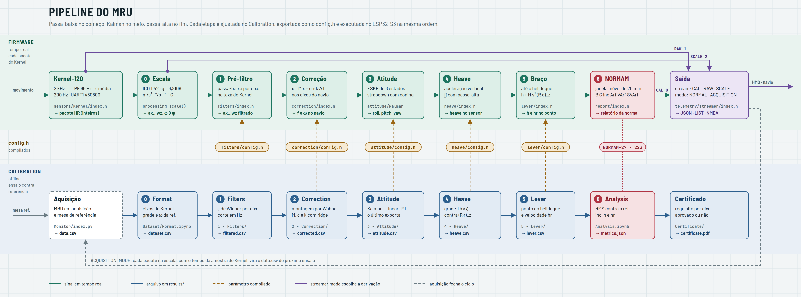
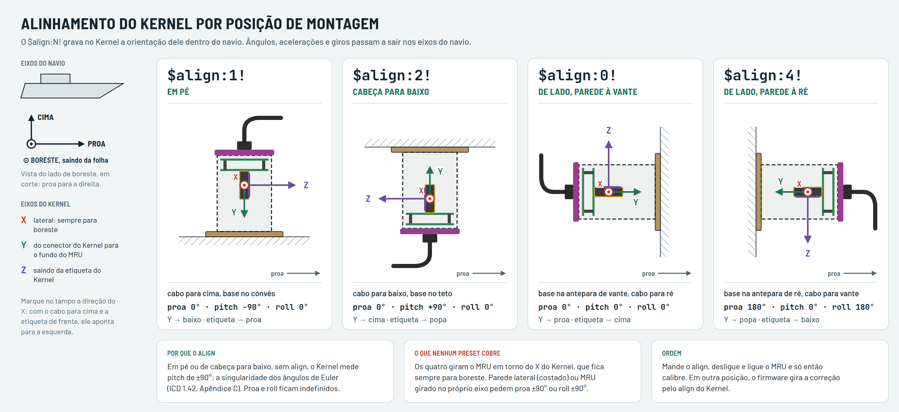

# MRU · firmware do ESP32-S3

O MRU é um Kernel-120 da Inertial Labs lido por um ESP32-S3. O ESP passa cada amostra do Kernel por um pipeline de
correção e entrega atitude, aceleração, giro, heave e taxa do heave por USB, RS232 ou RS422. Os parâmetros de cada etapa saem
dos notebooks de `Calibration/` como arquivos `config.h`, compilados junto com o firmware.



```
movimento → Kernel (2 kHz → LPF 66 Hz → média → 200 Hz) → escala → 1 pré-filtro → 2 correção → 3 atitude
          → 4 heave → 5 braço → saída (USB · RS232 · RS422)
               ↑ config.h de cada etapa, gerados pelos notebooks de Calibration/
```

| Etapa | Firmware (`Hardware/Embedded/Main/objects/processing/`) | Notebook que gera o `config.h` |
|---|---|---|
| Kernel | `../sensors/Kernel/index.h` (configurado no boot) | — |
| 0 · escala | `index.h` → `scale()` | — |
| 1 · pré-filtro | `filters/` | `Calibration/1 - Filters/1 - Model.ipynb` |
| 2 · correção | `correction/` e `align/` (gira a correção se o align do Kernel não for o do ensaio) | `Calibration/2 - Correction/1 - Model.ipynb` |
| 3 · atitude | `attitude/` (o `config.h` escolhe o modelo) | `Calibration/3 - Attitude/<estratégia>/` (a última que rodou) |
| 4 · heave | `heave/` | `Calibration/4 - Heave/1 - Model.ipynb` |
| 5 · braço | `lever/` | `Calibration/5 - Lever/1 - Model.ipynb` |
| saída | `../telemetry/streamer/index.h` | — |

**Do zero até o navio**

1. Compile e grave o firmware (seção 1) e confira o primeiro boot (seção 2).
2. Escolha a posição de montagem e mande o `$align:N!` dela (seção 4).
3. Faça o ensaio na mesa nessa mesma posição e rode os notebooks (seção 5).
4. Grave o firmware com os `config.h` novos e configure a saída para o navio (seção 6).


## 1. Placa e compilação

**Arduino IDE:** placa **ESP32-S3 Dev Module**, core `esp32` **3.3.12**, biblioteca **ArduinoJson 7.4.3**.

| Opção da IDE | Valor |
|---|---|
| USB CDC On Boot | **Enabled**. Sem isso o RS232 cai na mesma UART do `Serial` e o código não compila. |
| USB Mode | Hardware CDC and JTAG |
| Partition Scheme | a padrão, com OTA (o `Updater` grava pela partição OTA) |
| Demais | padrão |

**arduino-cli.** O binário vem dentro do AppImage da IDE:
`~/Apps/arduino-ide --appimage-extract "resources/app/lib/backend/resources/arduino-cli"`.

```bash
FQBN=esp32:esp32:esp32s3:CDCOnBoot=cdc
arduino-cli compile --fqbn $FQBN --export-binaries Hardware/Embedded/Main   # gera Main/build/esp32.esp32.esp32s3/Main.ino.bin
arduino-cli upload  --fqbn $FQBN -p /dev/ttyACM0 Hardware/Embedded/Main
```

**Pinos**

| Função | UART | Pinos | Baud |
|---|---|---|---|
| Console (`Serial`) | USB nativo | — | 115200, sempre |
| Kernel-120 | UART1 | TX 4 · RX 3 | 460800 (o firmware ajusta o Kernel no boot) |
| RS232 | UART0 | TX 11 · RX 10 | `baudrate` no modo normal, 460800 na aquisição |
| RS422 | UART2 | TX 12 · RX 13 | igual ao RS232 |
| LEDs | — | 1 e 2 | — |

O encoder está desligado no `Main.ino` porque usa os pinos 10 e 11 do RS232.


## 2. Primeiro boot

Abra o monitor serial no USB a 115200. O esperado é:

```
Device Mode: Normal
Kernel: parametro 0x03B2 gravado com 9        ← só no primeiro boot, ou quando algo no Kernel difere
Kernel: parametro 0x0012 gravado com 200
Kernel: parametro 0x03D0 gravado com 1
Kernel: parametro 0x03D7 gravado com 2
Kernel Mode: HR Mode
Kernel Align: proa 0.0, pitch -90.0, roll 0.0     ← o que o Kernel aplica desde que ligou; nan se ele não respondeu
pins tx=4 and rx=3 | 460800 bps | 200 Hz
Align: ensaio 0 -90 0 | Kernel 0 -90 0 | sem rotacao
Processing: kalman_fusion + filters + correction + heave + lever
Streamer Mode: Calibrated Mode
```

- O firmware procura o Kernel em 460800, 115200, 230400 e 921600. Depois lê taxa, baud, saída média e passa-baixa, e
  grava na flash do Kernel só o que for diferente. Por isso as linhas `gravado` não aparecem nos boots seguintes.
- Se apareceu alguma linha `gravado`, desligue e ligue o MRU. O Kernel só aplica o que está na flash quando liga
  (ICD 5.3.7), e reiniciar o ESP não desliga o Kernel.
- `Kernel nao respondeu em nenhum baud`: confira cabo e alimentação. Se o Kernel estiver num baud fora da lista,
  ligue-o na GUI da Inertial Labs e volte para 115200.
- Se o link físico não aguentar 460800, o Kernel fica gravado nesse baud e só a GUI o traz de volta. Nesse caso troque
  `KernelSensor::BAUD` e o código `0x09` em `PARAMETERS` (tabela 5.24 do ICD).

| LED | Piscando a cada 0,2 s | a cada 0,5 s | a cada 1 s | Apagado |
|---|---|---|---|---|
| 1 | — | Kernel ok | — | sem Kernel |
| 2 | stream ligado | — | comunicando por comando | sem comunicação |


## 3. Comandos

O ESP responde na porta que mandou o último comando (USB, RS232 ou RS422), e o stream passa a sair por ela.
Todo comando tem pelo menos 4 caracteres. São três formatos:

| Formato | Para quê | Exemplo | Resposta |
|---|---|---|---|
| `$comando!` | ação | `$stream_start!` | depende do comando |
| `CF:chave$valor!` | grava uma configuração e **reinicia o ESP** | `CF:frequency$10!` | `frequency set to 10` |
| `ID:chave$` | lê uma configuração | `ID:frequency$` | `$10!` |

Mande um `CF:` por vez e espere o ESP voltar antes do próximo. O firmware procura só `F:` e `D:`, então o comando
ainda vale se a primeira letra se perder na linha.

**Ações**

| Comando | Efeito |
|---|---|
| `$stream_start!` · `$stream_stop!` | liga e desliga o stream nesta porta |
| `$settings!` | todas as configurações em JSON |
| `$calibrate!` | o que o processamento está rodando (`kalman_fusion + filters + …` ou `kernel scale`) |
| `$check_sensor!` | `OK` ou `NOT WORKING` |
| `$firmware!` | versão do `Main.ino` |
| `$align:N!` | grava no Kernel a posição de montagem (seção 4) |
| `$ackoneledge!` | responde `$MICACK!` (teste de vida) |
| `$ERASE!` | volta as configurações ao padrão e reinicia |
| `MICRS` | reinicia |
| `updt` | entra em atualização por serial (seção 9) |

**Configurações** (ficam na flash do ESP, `Preferences`)

| Chave | Valores | Padrão |
|---|---|---|
| `device_mode` | 0 NORMAL · 1 ACQUISITION | 0 |
| `streamer_mode` | 0 CALIBRATED · 1 RAW · 2 SCALE | 0 |
| `kernel_mode` | 0 HR · 1 QT · 2 OR | 0 |
| `protocol` | 0 JSON · 1 LIST · 2 NMEA | 0 |
| `frequency` | Hz do stream no modo normal, até 200 | 100 |
| `baudrate` | baud do RS232 e do RS422 no modo normal | 9600 |
| `autostream` | 1 começa a transmitir no boot, sem `$stream_start!` | 0 |


## 4. Montagem e align

Dentro do MRU o Kernel fica de pé, preso pelo conector à placa. O eixo Y dele, o longitudinal, fica no eixo do
cilindro, apontando do tampo (lado do cabo) para a base. Com o MRU em pé e sem align, o Kernel mede pitch de −90°.
Nesse ponto os ângulos de Euler são singulares (ICD 1.42, Apêndice C): proa e roll ficam indefinidos.

O `$align:N!` grava na flash do Kernel a posição dele no navio (parâmetro `Alignment_Angles`, ICD Apêndice B). A
partir daí o Kernel entrega ângulos, acelerações e giros nos eixos do navio, em qualquer modo do ESP.

### 4.1 Qual align usar

| Posição do MRU | Comando | Proa · pitch · roll gravados | Kernel no navio |
|---|---|---|---|
| Em pé: cabo para cima, base no convés | `$align:1!` | 0° · −90° · 0° | Y para baixo, etiqueta para a proa |
| Cabeça para baixo: cabo para baixo, base no teto | `$align:2!` | 0° · +90° · 0° | Y para cima, etiqueta para a popa |
| De lado, base na antepara de vante (cabo para ré) | `$align:0!` | 0° · 0° · 0° | Y para a proa, etiqueta para cima |
| De lado, base na antepara de ré (cabo para vante) | `$align:4!` | 180° · 0° · 180° | Y para a popa, etiqueta para baixo |

`$align:3!` faz o mesmo que o `0`: zera os ângulos. Nas quatro posições o X do Kernel aponta para **boreste**: os
presets só giram o MRU em torno desse eixo.



### 4.2 Passo a passo

**Fisicamente**

1. **Marque o boreste no tampo.** Faça isso uma vez por MRU. Com o cabo para cima e a etiqueta do Kernel de frente
   para você, o X do Kernel aponta para a sua esquerda: é ali que vai a marca.
2. **Instale com a marca para boreste.**
   - **Em pé ou de cabeça para baixo:** gire o MRU em torno do próprio eixo até a marca apontar para boreste.
   - **Na parede:** a base vai numa antepara transversal, de vante ou de ré. Gire o cilindro até a marca ficar
     na horizontal, apontando para boreste. A etiqueta do Kernel fica então para cima (`0`) ou para baixo (`4`).
   - **Na mesa de calibração:** a marca aponta ao longo do eixo de pitch da mesa, para o lado que o roll positivo da
     mesa abaixa.

**Pelo protocolo (USB, RS232 ou RS422)**

3. **Mande o align da posição:** `$align:1!` (em pé). A resposta é `ALIGNMENT COMPLETE: 1`.
4. **Desligue e ligue o MRU.** O Kernel só aplica a flash quando liga (ICD 5.3.7). Reiniciar o ESP (`MICRS`) não
   basta, porque não desliga o Kernel.
5. **Confira o boot** no monitor serial do USB:
   ```
   Kernel Align: proa 0.0, pitch -90.0, roll 0.0      ← os ângulos do preset; nan se o Kernel não respondeu
   ```
6. **Confira o sentido.** Mande `CF:streamer_mode$2!` (SCALE, o Kernel puro) e deixe o MRU nivelado: pitch e roll
   ficam perto de 0°. Levante a proa e o pitch sobe. Abaixe o boreste e o roll sobe. Depois volte com
   `CF:streamer_mode$0!`.

**Na calibração**

7. **Calibre depois do align**, na seção 5, com o MRU na mesa na mesma posição. Registre o align do ensaio em
   `Calibration/Dataset/testN/info.json`, como `{"align": [0, -90, 0]}` para em pé.
8. **Instalou em outra posição?** Mande o align da posição nova e desligue e ligue de novo. No modo calibrado, o
   `processing/align` lê o align do Kernel no boot e gira a correção do ensaio para os eixos novos. O boot mostra
   `Align: ensaio 0 -90 0 | Kernel 0 0 0 | correcao girada`, e o `$calibrate!` mostra `+ align`. Nos modos SCALE e RAW
   não há o que girar: o Kernel já entrega nos eixos do navio.

### 4.3 O que cada erro causa

| Erro | Efeito |
|---|---|
| Marca de boreste apontando para a proa | pitch e roll trocam de lugar |
| Marca de boreste apontando para bombordo | pitch e roll trocam de sinal |
| Não desligar e ligar depois do align | o Kernel segue no align antigo até o próximo boot; se o ensaio for gravado assim, a calibração fica no align errado |
| Ensaio sem `"align"` no `info.json` | o firmware não gira a correção: ela só vale na posição do ensaio |
| Align de uma posição, MRU montado noutra | ângulos, acelerações e giros saem em eixos trocados |

### 4.4 Precisão fora da posição do ensaio

A rotação leva o giroscópio inteiro para a posição nova. O acelerômetro tem um limite que vem do ensaio. Em pé, o eixo
que fica na vertical nunca tem o viés separado da escala. Em outra posição, esse viés (1,5 a 2,5 mg no Kernel-120) vai
para o pitch ou o roll.

Simulação de ponta a ponta, com erros de datasheet: ensaio em pé com align 1, pelo Monitor, pelos notebooks e pela
réplica no PC da cadeia do firmware. Erro RMS de pitch e roll:

| Onde o MRU fica | Mesa `Table2.ino` (um eixo por vez) | Mesa `Table.ino` (em fase) |
|---|---|---|
| Na posição do ensaio | 0,001° | 0,003° |
| Em outra posição, com o `processing/align` | 0,003° a 0,03° | 0,02° a 0,16° |
| Em outra posição, sem girar a correção | até 0,11° | até 0,11° |

Em 12 sorteios de erros do Kernel, girar ganhou de não girar em média e no pior caso, nas três posições e com as duas
mesas. O giro fica de 2 a 20 vezes melhor.

A melhor precisão continua sendo calibrar na posição de bordo, com uma mesa que mova um eixo por vez.

**Posições que os presets não cobrem.** No costado (parede lateral), o Y do Kernel aponta para o través e a montagem
pede proa ±90°. Com a marca na vertical, a montagem pede roll ±90°. Nenhum preset tem esses ângulos. Para esses
casos, acrescente o preset em `KernelSensor::align` (`Hardware/Embedded/Main/objects/sensors/Kernel/index.h`) ou
grave os ângulos pela GUI da Inertial Labs, em *Devices Options → Alignment angles*. O `processing/align` aceita
qualquer ângulo lido do Kernel.


## 5. Calibração: modo aquisição

A aquisição grava o que o Kernel entrega, só convertido para unidades, com a mesa de referência ao lado.

1. **Montagem:** MRU na mesa na posição em que vai a bordo, com o `$align:N!` dela, e desligado e ligado depois do
   align (seção 4). A marca de boreste aponta ao longo do eixo de pitch da mesa, para o lado que o roll positivo da
   mesa abaixa.
2. **Aquisição:** pelo USB, mande `CF:device_mode$1!`. O ESP reinicia com `Device Mode: Acquisition` e
   `Streamer Mode: Scale Mode`, e já transmite LIST em SCALE, **um pacote por amostra do Kernel (200 linhas/s)**, com
   o tempo da amostra. O RS232 e o RS422 vão para 460800.
3. **Ensaio:** nivele a mesa e só então ligue (`Hardware/Table` não faz homing: o zero dos ângulos é a posição em que
   os motores ligam). Ligue o MRU em qualquer porta e rode:
   ```bash
   cd Monitor && python index.py
   ```
   O Monitor acha sozinho a porta e o baud do MRU. Primeiro ele só ouve, para não soltar a mesa sem querer, e fica com
   a porta muda que sobrar como mesa. Ele segura a mesa parada por 20 s (o trecho `static`) e depois a solta. Cada
   amostra vai para o disco enquanto o ensaio corre. A tecla `q` (ou Ctrl+C) encerra e monta os arquivos em
   `Monitor/output/<data_hora>/`. Nos primeiros balanços, confira na janela (teclas `p` e `r`) que o pitch e o roll do
   MRU acompanham os da mesa com o mesmo sinal.

   O Monitor precisa de `pyserial`, `pandas`, `numpy`, `scipy` e `matplotlib`. No `data.csv`, a mesa passa por uma
   spline suavizada nos instantes do MRU. Ela chega a 10 Hz, em degraus de 0,025°, e o `Format` e o `4 - Heave` derivam
   esse sinal duas vezes. O `static` vale só onde a mesa ficou parada meio segundo antes e meio segundo depois.

   **A mesa e o ensaio.** O `Table.ino` move pitch e roll juntos, em fase, 15·sin(t), e só fica parado nos 20 s
   iniciais. Na simulação, isso calibra bem a posição do ensaio, com dois cuidados:
   - **Ordem dos eixos da mesa:** o `Format` lê a mesa como Euler xyz, com o pitch no eixo de fora, preso na base, e
     o roll no eixo de dentro. Com os dois eixos andando juntos, a ordem trocada desloca a referência em até 0,7° a
     15°. Com uma etapa por vez, como no `Table2.ino`, a ordem não importa.
   - **Paradas inclinadas:** paradas em ±15° e ±30° calibram a escala do acelerômetro e melhoram as outras posições
     (seção 4.4).

   O `Table2.ino` faz homing nos fins de curso e roda etapas de 100 s: pitch, roll e repouso, a 0,3 Hz. Na simulação
   ele calibra melhor que o `Table.ino`: heave de 1,9 mm contra 5,6 mm, e as outras posições até 0,03° (seção 4.4).
   O Monitor o reconhece pelo JSON e o reinicia no começo da sessão. Espere o homing e grave pelo menos 300 s, para o
   ensaio pegar o repouso.
4. **Dados:** copie o `data.csv` dessa pasta para um teste novo, `Calibration/Dataset/testN/files/data.csv`, e ajuste
   `"test": N` em `Calibration/info.json`. Crie também `Dataset/testN/info.json` com o align que o Kernel tinha no
   ensaio, como `{"align": [0, -90, 0]}` para em pé. O `2 - Correction` leva esse align para
   `processing/align/config.h`; sem ele, o firmware não gira a correção. O mesmo arquivo aceita `axes`, que só serve
   para dados formatados fora do Monitor.
5. **Notebooks, nesta ordem.** Cada um lê a saída do anterior em `Dataset/testN/results/`:

   | Ordem | Notebook | Grava |
   |---|---|---|
   | 0 | `Dataset/Format.ipynb` | `dataset.csv` |
   | 1 | `1 - Filters/1 - Model.ipynb` | `filtered.csv` · `filters/config.h` |
   | 2 | `2 - Correction/1 - Model.ipynb` | `corrected.csv` · `correction/config.h` · `align/config.h` |
   | 3 | `3 - Attitude/<KalmanFusion · LinearFit · MachineLearning>` (rode por último a estratégia que vai para o MRU) | `attitude.csv` · `attitude/config.h` |
   | 4 | `4 - Heave/1 - Model.ipynb` | `heave.csv` · `heave/config.h` |
   | 5 | `5 - Lever/1 - Model.ipynb` (`POINT` = distância até o helideque) | `lever.csv` · `lever/config.h` |
   | 6 | `Analysis.ipynb` → `Certificate/1 - Certificate.ipynb` | métricas e `release/certificate.pdf` |

   Pela linha de comando, use o kernel `base` do conda (o Jupyter do sistema está quebrado):
   ```bash
   ~/miniconda3/bin/jupyter nbconvert --to notebook --execute --inplace --ExecutePreprocessor.kernel_name=base "1 - Model.ipynb"
   ```
   A 200 Hz o pipeline inteiro leva cerca de 75 minutos: o `1 - Filters` uns 18 e o `KalmanFusion` perto de uma
   hora. Os outros notebooks levam segundos.
6. **Firmware:** compile e grave o `Main/` (seção 1). Os `config.h` novos já estão nas pastas das etapas.
7. Volte ao modo normal (seção 6).


## 6. A bordo: modo normal

```
CF:device_mode$0!       ← volta ao normal (reinicia)
CF:streamer_mode$0!     ← cadeia calibrada: atitude, aceleração, giro, heave e taxa do heave
CF:protocol$2!          ← 0 JSON · 1 LIST · 2 NMEA, o que o sistema do navio espera
CF:frequency$10!        ← Hz do stream
CF:baudrate$115200!     ← RS232 e RS422
CF:autostream$1!        ← transmite sozinho ao ligar
```

O baud precisa caber no pacote. Com ~10 bits por byte, `baudrate ≥ 10 × bytes × frequency`:

| Pacote | Bytes | 9600 aguenta | 115200 aguenta |
|---|---|---|---|
| NMEA `$GPPASHR` | ~45 | 20 Hz | 200 Hz |
| LIST calibrado (13 campos) | ~90 | 10 Hz | 125 Hz |
| JSON calibrado | ~175 | 5 Hz | 65 Hz |

Três valores dependem da instalação e saem dos notebooks com o valor da mesa. Troque os três antes de embarcar:

- `LEVER_POINT` (`lever/config.h`): o `POINT` do `5 - Lever`, a distância do MRU ao centro do helideque em metros,
  nos eixos do navio (x proa, y boreste, z para baixo).
- `HEAVE_PERIOD` (`heave/config.h`): o `Th` do `4 - Heave`. O valor da mesa fica perto de 1 s; no mar, use o período
  das ondas, de 5 a 20 s.
- `KALMAN_LEVER` (`attitude/kalman/config.h`): o Kalman tira do acelerômetro a aceleração do giro em torno deste
  ponto, e o notebook ajusta o pivô da mesa. A bordo, use o vetor do centro de giro do navio até o MRU, nos mesmos
  eixos. Se ele não for conhecido, use zero.


## 7. Pacotes

Todo pacote começa pelo tempo da amostra do Kernel, em segundos desde o início do stream.

| Modo | LIST (na ordem) |
|---|---|
| RAW · SCALE (HR/OR) | `time, tmp, pitch, roll, yaw, ax, ay, az, wx, wy, wz, heave` (`heave` fica em 0: não há heave sem a cadeia) |
| CALIBRATED (HR/OR) | os 12 acima + `heave_rate` |
| QT | `time, tmp, pitch, roll, yaw, q0, q1, q2, q3, heave` |

- **JSON:** os mesmos campos, com esses nomes.
- **NMEA:** `$GPPASHR,pitch,roll,yaw,heave*CS`.
- **RAW:** os inteiros como o Kernel manda (aceleração em g·1e6, giro em °/s·1e5, ângulos em °·1e3, temperatura em
  °C·10).

| Campos (fora do RAW) | Unidade |
|---|---|
| `ax ay az` | m/s², nos eixos do navio |
| `wx wy wz` | °/s |
| ângulos | ° |
| `heave` | m, positivo para baixo, no ponto de interesse |
| `heave_rate` | m/s, a derivada do `heave` |
| `tmp` | °C |

As grandezas das NORMAM (B, C, inclinação, Arf, VArf, SVArf, em janela de 20 minutos) saem destes campos no sistema
que recebe o pacote: o MRU entrega o sinal no ponto de interesse e não guarda a janela.


## 8. Diagnóstico e monitoração

| Para ver | Mande |
|---|---|
| os inteiros do Kernel, sem nada do ESP | `CF:streamer_mode$1!` (RAW) |
| o Kernel em unidades, sem filtro nem modelo | `CF:streamer_mode$2!` (SCALE) |
| o que está compilado | `$calibrate!` |
| se o Kernel está vivo | `$check_sensor!` |
| as configurações | `$settings!` ou `ID:chave$` |

**Só monitorar.** Rode o mesmo `cd Monitor && python index.py` sem a mesa ligada. Ele aceita o MRU em qualquer modo e
protocolo (LIST de 12, 13 ou 10 campos, JSON ou NMEA) e em qualquer baud da lista (460800, 115200, 9600, 921600,
230400, 57600, 38400, 19200, 4800), e grava `target.csv` na pasta da sessão.

- **Portas fixas:** preencha `MRU_PORT` e `TABLE_PORT` no topo do `Monitor/index.py`.
- **Sessões longas:** `PLOT = False` grava sem abrir janela.
- **Teclas da janela:** `p r y` pitch, roll e yaw · `a` aceleração · `w` giro · `h` heave ·
  `o` quaternion · `t` temperatura · `q` sai e salva.


## 9. Atualização por serial (OTA)

1. Gere o binário com `arduino-cli compile --fqbn $FQBN --export-binaries Hardware/Embedded/Main`, ou na IDE em
   *Sketch → Export Compiled Binary*.
2. Rode `cd Updater && python index.py`. Ele sincroniza com `$ackoneledge!`, manda `__updt__` e envia
   `Main/build/esp32.esp32.esp32s3/Main.ino.bin` em blocos base64. No fim, o ESP reinicia sozinho.

A porta é `/dev/ttyACM0`, definida no `Updater/index.py`. As configurações gravadas sobrevivem à atualização.
