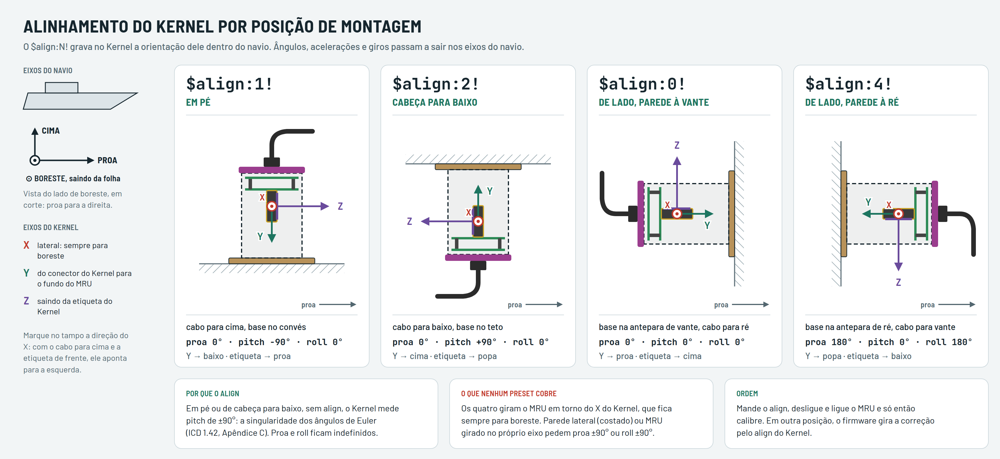

# MRU — aquisição, calibração e firmware do ESP32-S3

O projeto lê um **Kernel-120 da Inertial Labs** com um **ESP32-S3**, processa as
medições e transmite atitude, aceleração, giro, heave e velocidade vertical por
**USB, RS232 ou RS422**. O computador grava ensaios e calcula a calibração; o
ESP32 usa os parâmetros exportados em `config.h` para processar novas amostras.

## Estrutura

```text
MRU/
├── Hardware/
│   ├── Embedded/Main/
│   │   ├── Main.ino                 # firmware principal: gravar no ESP32-S3
│   │   ├── device/                  # inicialização, configurações e tarefas
│   │   ├── globals/constants.h      # códigos dos modos e protocolos
│   │   └── objects/
│   │       ├── sensors/Kernel/      # leitura e configuração do Kernel-120
│   │       ├── processing/          # algoritmos e config.h da calibração
│   │       ├── telemetry/           # serial, comandos e formatos de saída
│   │       ├── updater/             # atualização do firmware pela serial, com CRC e rollback
│   │       └── health/              # diário de eventos e sinais de vida ($diagnostics!, $log!)
│   ├── Embedded/Host/              # o firmware real no PC, com Kernel falso, para testar sem hardware
│   ├── Table/                      # Table.ino: firmware da plataforma de referência, em outra placa
│   ├── Encoder/                    # teste isolado do encoder
│   └── Listener/                   # ponte serial auxiliar em 9600
├── Monitor/                        # app MRU Monitor (Tauri): monitor, aquisição, calibração, produção e HMS
├── Calibration/
│   ├── info.json                   # identificação, teste selecionado e gravidade
│   ├── Dataset/Format.ipynb         # preparação dos dados do ensaio
│   ├── Dataset/testN/              # files/data.csv, info.json e results/
│   ├── 1 - Filters/                # filtros dos sensores
│   ├── 2 - Correction/             # correção de montagem, escala, viés e temperatura
│   ├── 3 - Attitude/               # KalmanFusion, LinearFit ou MachineLearning
│   ├── 4 - Heave/                  # deslocamento vertical
│   ├── 5 - Lever/                  # movimento vertical no ponto de interesse
│   ├── Analysis.ipynb              # métricas e gráficos
│   └── Certificate/                # certificado PDF
├── Analysis/                       # estudos fora do fluxo principal
└── Documents/                      # diagramas e documentação de hardware
```

Os `.h` de Main e os `index.py` internos são módulos: **não são executados
separadamente**. Encoder e Listener não são pré-requisitos para usar o MRU.

## Pipeline geral

Visão geral do funcionamento do MRU, extraída do datasheet:


## Instalação

### MRU Monitor (app)

O Monitor é um aplicativo desktop. Instalação, execução no Tauri, geração do executável para Linux e Windows, o MRU
simulado e a referência em debug estão em [`Monitor/README.md`](Monitor/README.md).

### Python: notebooks de calibração

Os exemplos usam Linux/Bash e Python 3.12. Se já tem o repositório, comece na
pasta `MRU/`.

```bash
git clone https://github.com/KlaussMarchi/MRU.git
cd MRU
python3 -m venv .venv
source .venv/bin/activate
python -m pip install --upgrade pip

# Calibração e certificado
python -m pip install jupyterlab nbconvert ipykernel "scikit-learn>=1.4" joblib tqdm multiprocess reportlab

python -m ipykernel install --prefix "$VIRTUAL_ENV" --name mru --display-name "Python (MRU)"
```

No Ubuntu/Debian, se faltar `venv` ou suporte à janela de gráficos, instale
`sudo apt install python3-venv python3-tk`. No Windows, crie o ambiente com
`python -m venv .venv`, ative com `.venv\Scripts\Activate.ps1` e use
`--prefix "$env:VIRTUAL_ENV"` no comando do kernel. **Ative o ambiente novamente
em cada terminal** antes de rodar os programas.

### Arduino: firmware do MRU

1. Instale a [Arduino IDE](https://www.arduino.cc/en/software/).
2. Em **Preferências → URLs adicionais do Gerenciador de Placas**, adicione
   `https://espressif.github.io/arduino-esp32/package_esp32_index.json`.
3. No **Gerenciador de Placas**, instale **esp32 by Espressif Systems 3.3.12**.
4. No **Gerenciador de Bibliotecas**, instale **ArduinoJson 7.4.3**.
   Para a plataforma de referência, instale também **FastAccelStepper**; a versão presente no
   ambiente do projeto é **1.4.0**.

A instalação do core segue o [guia da Espressif](https://docs.espressif.com/projects/arduino-esp32/en/latest/installing.html).
`Preferences`, `HardwareSerial`, `Update` e FreeRTOS já vêm com o core ESP32.

Abra [`Hardware/Embedded/Main/Main.ino`](Hardware/Embedded/Main/Main.ino), mantendo
toda a pasta `Main/`, e selecione:

| Opção da IDE | Valor para o MRU |
| --- | --- |
| Placa | **ESP32S3 Dev Module** |
| USB CDC On Boot | **Enabled**; libera UART0 para RS232. Desabilitado causa erro de compilação. |
| USB Mode | **Hardware CDC and JTAG** |
| Partition Scheme | Padrão com OTA; necessário para atualizar pelo MRU Monitor. |
| Porta | USB nativo do ESP32-S3 conectado ao computador. |

Clique em **Verificar** e depois **Carregar**. O firmware já contém `config.h`;
é possível iniciar o equipamento antes de refazer a calibração.

**Alternativa pelo terminal:** instale o
[arduino-cli](https://docs.arduino.cc/arduino-cli/installation/) e execute na raiz:

```bash
arduino-cli core update-index --additional-urls https://espressif.github.io/arduino-esp32/package_esp32_index.json
arduino-cli core install esp32:esp32@3.3.12 --additional-urls https://espressif.github.io/arduino-esp32/package_esp32_index.json
arduino-cli lib install "ArduinoJson@7.4.3"

MRU_FQBN='esp32:esp32:esp32s3:CDCOnBoot=cdc,USBMode=hwcdc'
MRU_BUILD='Hardware/Embedded/Main/build/esp32.esp32.esp32s3'
arduino-cli compile --fqbn "$MRU_FQBN" --output-dir "$MRU_BUILD" Hardware/Embedded/Main
arduino-cli board list
arduino-cli upload --fqbn "$MRU_FQBN" --port /dev/ttyACM0 --input-dir "$MRU_BUILD" Hardware/Embedded/Main
```

Troque `/dev/ttyACM0` pela porta encontrada. O binário `Main.ino.bin` fica no
caminho que o MRU Monitor oferece em Dispositivo → Atualizar firmware. Os comandos não gravam a placa da plataforma de referência.

## Uso rápido e ordem dos códigos

| Objetivo | Ordem |
| --- | --- |
| Ver medições | Gravar Main → abrir o MRU Monitor → Monitor (porta e baud automáticos). |
| Calibrar | Gravar Main e Table nas respectivas placas → ajustar montagem → MRU Monitor: Aquisição ("Para calibração") → gravar → Calibração → Produção (envia a calibração pela serial e prepara a saída). |
| Reprocessar ensaio existente | Preparar `Dataset/testN/` e `Calibration/info.json` → executar notebooks → recompilar Main para aplicar os parâmetros. |
| Atualizar MRU em funcionamento | Compilar Main → MRU Monitor: Dispositivo → Atualizar firmware, ou carregar novamente pela IDE/CLI. |

### Antes de escolher o modo

Grave Main e ajuste a [montagem e o align](#montagem-e-alinhamento). Escolha a
porta e o baud indicados em cada etapa do roteiro. Envie **um comando por vez**:
cada `CF:` salva a configuração e reinicia o
ESP32. Espere o boot e reabra a porta, se necessário, antes do próximo.
`$check_sensor!` deve responder `OK`.

As explicações entre parênteses são apenas para leitura: **envie somente o
comando, até o `!`, sem os parênteses**.

Se o boot mostrar parâmetros do Kernel sendo gravados, desligue e ligue o
MRU para aplicar os ajustes que dependem da alimentação do sensor.
Os dados abaixo são **exemplos ilustrativos do formato serial**, não medições
reais nem uma comparação de precisão entre os modos.

| Roteiro | Configuração principal | Saída do exemplo | Baud no receptor |
| --- | --- | --- | --- |
| [1. Aquisição](#1-modo-de-aquisição) | `device_mode=1`, `kernel_mode=0`; SCALE/LIST forçados | LIST, até 200 Hz | USB **115200**; RS232/RS422 **460800** |
| [2. Normal sem calibração](#2-modo-normal-sem-calibração) | `device_mode=0`, `streamer_mode=2`, `kernel_mode=0` | JSON, 10 Hz | USB/RS232/RS422 **115200**, conforme configurado abaixo |
| [3. Normal com calibração](#3-modo-normal-com-calibração) | `device_mode=0`, `streamer_mode=0`, `kernel_mode=0` | JSON, 10 Hz | USB/RS232/RS422 **115200**, conforme configurado abaixo |

## 1. Modo de Aquisição

**Para quê:** gravar um ensaio com MRU e plataforma de referência para calcular a calibração no
computador. Usa sensores e ângulos do Kernel em unidades físicas, sem aplicar
filtros, correção ou modelo de atitude do projeto.

**Durante a aquisição: RS232/RS422 em 460800 baud (recomendado); USB nativo
em 115200.** O conversor USB–RS232/RS422 deve ser configurado em **460800**;
ele não usa o baud do USB nativo. Nas UARTs, use **8N1, sem controle de fluxo**.

**No ESP32 e na plataforma de referência:** grave Main no MRU e
[`Table/Table.ino`](Hardware/Table/Table.ino), dentro de `Hardware/`, na placa
da plataforma de referência. O firmware dela fica diretamente em **`Hardware/Table/`**.
Confira pinos, fins de curso e recuos de homing. Depois do homing a plataforma
fica parada esperando o `start` do Monitor; `stop` a leva de volta a zero.
Aguarde o homing terminar. Escolha **um** dos caminhos abaixo para o MRU.

### 1.1. Aquisição por RS232 ou RS422 — recomendado

**Etapa A — configurar antes de entrar em aquisição.** Abra o terminal na
porta do conversor usando o baud em que o MRU está funcionando agora:

- **9600** se estiver em modo normal com a configuração de fábrica.
- **115200** se estiver em modo normal configurado pelos exemplos deste guia.
- **460800** se já estiver em aquisição.
- Se gravou outro `baudrate` para o modo normal, use aquele valor.

Nesse baud, envie os dois comandos abaixo, aguardando cada reinício.
**Não mude para 460800 antes de enviar `CF:device_mode$1!`.**

```text
CF:kernel_mode$0!   (no baud atual: colocar o Kernel em HR, com sensores e ângulos em alta resolução)
CF:device_mode$1!   (no mesmo baud: ativar aquisição; após reiniciar, RS232/RS422 passam a 460800)
```

**Etapa B — após o reinício: mude o terminal/conversor para 460800 baud.**
Reabra a porta nesse baud e envie:

```text
$check_sensor!     (enviar em 460800: verificar o Kernel; deve responder OK)
$stream_start!     (enviar em 460800: selecionar esta porta RS232/RS422 e transmitir por ela)
```

**Etapa C — coletar: mantenha o receptor em 460800 durante todo o ensaio.**
A aquisição fixa esse baud mesmo que `baudrate` esteja salvo como 9600 ou
115200. Não é necessário enviar `CF:baudrate$460800!`.

Se não souber o baud atual do RS232/RS422, configure pelo USB conforme o
próximo roteiro; depois abra o conversor em **460800** e faça a etapa B por ele.

### 1.2. Aquisição pelo USB nativo — alternativa

**Etapas A e B — configurar e reiniciar: USB em 115200 o tempo todo.**
Abra o Monitor Serial na porta USB nativa do ESP32-S3 e envie um comando por
vez, aguardando cada reinício:

```text
CF:kernel_mode$0!   (enviar pelo USB em 115200: colocar o Kernel em HR, com sensores e ângulos em alta resolução)
CF:device_mode$1!   (enviar pelo USB em 115200: ativar aquisição; USB continua em 115200 após reiniciar)
$check_sensor!     (enviar pelo USB em 115200: verificar o Kernel; deve responder OK)
$stream_start!     (enviar pelo USB em 115200: selecionar o USB e transmitir por ele)
```

**Etapa C — coletar: mantenha o USB nativo em 115200 durante todo o ensaio.**
Não troque o USB para 460800. Ao ativar aquisição, somente RS232/RS422 mudam
para 460800; o USB continua em 115200.

### 1.3. Gravar no computador

| Ligação usada na coleta | Baud durante toda a aquisição |
| --- | --- |
| **MRU por RS232 ou RS422 — recomendado** | **460800** |
| **MRU por USB nativo — alternativa** | **115200** |
| **Plataforma de referência, em sua própria porta serial** | **115200** |

A aquisição força **SCALE + LIST + início automático**, até 200 Hz, ignorando
frequência e protocolo salvos. O destino inicial é RS232; `$stream_start!`
pela porta escolhida seleciona onde os dados vão sair.

No **MRU Monitor**, abra **Aquisição**, escolha **"Para calibração"** e clique em
**Aplicar no MRU**: o app manda `kernel_mode=0` e `device_mode=1` por `CS:`, reinicia o MRU uma vez, reabre a porta
em 460800 (RS232/RS422) e sincroniza pelo ACK. Na barra **Plataforma de referência**, conecte a plataforma
(Table.ino a 115200). Inicie a gravação: no mesmo instante o app manda `start` e a plataforma fica 20 s parada (o trecho
`static`), depois alterna **100 s de pitch, 100 s de roll e 100 s de repouso** em ciclo, com amplitude de 15° e
frequência de 0,3 Hz; parar a gravação manda `stop`. Grave pelo menos **320 s**, pare e salve: a sessão vai para `Monitor/Data/Sessions/<data_hora>/`
com `target.csv`, `reference.csv`, `data.csv` (MRU + plataforma casados, coluna `static`) e `info.json`.

Sem plataforma de referência válida, a sessão produz apenas `target.csv`, insuficiente para calibrar.

**Exemplo no serial do MRU:** LIST com 13 campos, intervalo nominal de 0,005 s.
O ESP32 também calcula os dois últimos campos usando os dados do Kernel.

```text
[1.000,25.000,0.100,-0.200,30.000,0.034,0.017,9.810,0.010,-0.020,0.000,0.002,0.001]
[1.005,25.000,0.101,-0.199,30.000,0.034,0.017,9.811,0.011,-0.020,0.000,0.002,0.001]
```

Ordem: `time, tmp, pitch, roll, yaw, ax, ay, az, wx, wy, wz, heave, heave_rate`.
Na **porta separada da plataforma**, as linhas têm este formato:

```json
{"t":1.000,"pitch":7.13,"roll":0.00}
```

## 2. Modo Normal sem Calibração

**Para quê:** usar sensores e ângulos do Kernel, sem aplicar a calibração
produzida pelos notebooks. Aqui, “sem calibração” significa **SCALE**;
a configuração interna e o align do próprio Kernel continuam valendo.
O ESP32 ainda calcula heave e velocidade vertical com os parâmetros de
heave/braço compilados. RAW serve para inspecionar os inteiros brutos.

**No ESP32:** basta gravar Main; não precisa rodar os notebooks para este modo.
Configure pelo **USB nativo em 115200 em todos os comandos**, aguardando cada
reinício. O baud do receptor em cada etapa é:

| Etapa | USB nativo | RS232/RS422 |
| --- | --- | --- |
| Antes de `CF:device_mode$0!` | **115200** | **460800** se vier da aquisição; caso contrário, baud normal salvo. |
| Após `CF:device_mode$0!` e até configurar `baudrate` | **115200** | Baud normal salvo: **9600** de fábrica ou o valor configurado anteriormente. |
| Após `CF:baudrate$115200!` reiniciar e durante o uso | **115200** | **115200** |

Envie este bloco pelo USB em **115200**; ele configura também as duas UARTs:

```text
CF:device_mode$0!     (colocar o ESP32 em operação normal, usando as configurações salvas)
CF:kernel_mode$0!     (colocar o Kernel em HR: ângulos, aceleração e giro em alta resolução, mais temperatura)
CF:streamer_mode$2!   (usar SCALE: leituras em unidades físicas, sem aplicar a calibração do projeto)
CF:protocol$0!        (enviar os dados em JSON, com o nome de cada campo)
CF:frequency$10!      (transmitir 10 amostras por segundo)
CF:baudrate$115200!   (configurar RS232 e RS422 em 115200 baud; não altera o USB)
CF:autostream$0!      (desativar a transmissão automática ao ligar; aguardar stream_start)
$check_sensor!       (verificar se o Kernel está funcionando; deve responder OK)
$stream_start!       (selecionar esta porta e iniciar a transmissão dos dados por ela)
```

Isso seleciona **NORMAL + HR + SCALE + JSON a 10 Hz**. USB, RS232 e RS422 usam
**115200** neste exemplo. Para receber por outra porta, envie `$stream_start!`
por ela; com `autostream=0`, repita após cada reinício.

**No computador:** abra o **MRU Monitor → Monitor** e clique em **Conectar** (porta e baud automáticos). Para
gravar, use **Aquisição → "Escala do Kernel"**; para operar com outro receptor serial, não é necessário o app.

**Exemplo no serial:** uma linha JSON por amostra, intervalo nominal de 0,100 s.

```json
{"time":1.000,"tmp":25.000,"pitch":0.100,"roll":-0.200,"yaw":30.000,"ax":0.034,"ay":0.017,"az":9.810,"wx":0.010,"wy":-0.020,"wz":0.000,"heave":0.002,"heave_rate":0.001}
{"time":1.100,"tmp":25.000,"pitch":0.101,"roll":-0.199,"yaw":30.000,"ax":0.034,"ay":0.017,"az":9.811,"wx":0.011,"wy":-0.020,"wz":0.000,"heave":0.002,"heave_rate":0.001}
```

SCALE mantém os eixos do Kernel: **X boreste, Y proa, Z para cima**.
`$calibrate!` deve responder `kernel scale + heave + lever`.

## 3. Modo Normal com Calibração

**Para quê:** usar filtros, correção de sensores, modelo de atitude, heave e
braço de alavanca ajustados para o equipamento.

**Antes de usar:** faça a aquisição, execute os
[notebooks na ordem indicada](#2-executar-os-notebooks-nesta-ordem) e
**recompile/grave Main** para incorporar os novos `config.h`. Se o firmware
já contém a calibração desejada, basta selecionar o modo; não precisa refazer
os notebooks em cada uso. Escolher CALIBRATED não calcula uma calibração nova.

**No ESP32:** configure pelo **USB nativo em 115200 em todos os comandos**,
aguardando cada reinício. O baud do receptor em cada etapa é:

| Etapa | USB nativo | RS232/RS422 |
| --- | --- | --- |
| Antes de `CF:device_mode$0!` | **115200** | **460800** se vier da aquisição; caso contrário, baud normal salvo. |
| Após `CF:device_mode$0!` e até configurar `baudrate` | **115200** | Baud normal salvo: **9600** de fábrica ou o valor configurado anteriormente. |
| Após `CF:baudrate$115200!` reiniciar e durante o uso | **115200** | **115200** |

Envie este bloco pelo USB em **115200**; ele configura também as duas UARTs:

```text
CF:device_mode$0!     (colocar o ESP32 em operação normal, usando as configurações salvas)
CF:kernel_mode$0!     (colocar o Kernel em HR: ângulos, aceleração e giro em alta resolução, mais temperatura)
CF:streamer_mode$0!   (usar CALIBRATED: aplicar filtros, correção e modelos dos config.h compilados)
CF:protocol$0!        (enviar os dados em JSON, com o nome de cada campo)
CF:frequency$10!      (transmitir 10 amostras por segundo)
CF:baudrate$115200!   (configurar RS232 e RS422 em 115200 baud; não altera o USB)
CF:autostream$0!      (desativar a transmissão automática ao ligar; aguardar stream_start)
$check_sensor!       (verificar se o Kernel está funcionando; deve responder OK)
$stream_start!       (selecionar esta porta e iniciar a transmissão dos dados por ela)
```

Isso seleciona **NORMAL + HR + CALIBRATED + JSON a 10 Hz**. USB, RS232 e RS422
usam **115200** neste exemplo. Se o destino for um conversor, envie
`$stream_start!` pela porta dele após configurar.

**No computador:** o **MRU Monitor → Monitor** mostra a saída calibrada; a tela **Produção** faz toda esta
configuração de uma vez (calibração pela serial, protocolo, frequência, porta de saída, baud e autostream).

**Exemplo no serial:** mesmos 13 campos de SCALE, agora com sensores corrigidos
e atitude calculada pelo modelo.

```json
{"time":1.000,"tmp":25.000,"pitch":0.100,"roll":-0.200,"yaw":30.000,"ax":0.017,"ay":0.034,"az":-9.785,"wx":-0.020,"wy":0.010,"wz":0.000,"heave":0.002,"heave_rate":0.001}
{"time":1.100,"tmp":25.000,"pitch":0.101,"roll":-0.199,"yaw":30.000,"ax":0.017,"ay":0.034,"az":-9.786,"wx":-0.020,"wy":0.011,"wz":0.000,"heave":0.002,"heave_rate":0.001}
```

CALIBRATED entrega **x proa, y boreste, z para baixo**. Com o modelo atual,
`$calibrate!` responde `kalman_fusion + filters + correction + heave + lever`,
com `+ align` quando a adaptação de montagem estiver ativa.

**Para saída NMEA:** envie `CF:protocol$2!`, espere o reinício e envie
`$stream_start!` na porta de saída. O mesmo exemplo fica:

```text
$GPPASHR,0.100,-0.200,30.000,0.002*50
```

Para iniciar automaticamente ao ligar, use `CF:autostream$1!`. O destino
inicial é RS232; USB/RS422 precisam de um comando pela respectiva porta para
selecioná-la. NMEA também está disponível no modo normal sem calibração.

## MRU Monitor

| Tela | O que faz |
| --- | --- |
| Monitor | Leituras e gráficos ao vivo em qualquer modo e protocolo (LIST, JSON, NMEA; SCALE, CALIBRATED, RAW, QT), saúde do stream e terminal. |
| Aquisição | Configura o modo com `CS:` + um reinício, sincroniza e grava MRU + plataforma de referência. |
| Calibração | Roda o pipeline de `Monitor/Pipeline` sobre uma sessão e gera o pacote da calibração. |
| Produção | Envia a calibração pela serial e deixa o MRU transmitindo sozinho ao ligar (NMEA por padrão). |
| Dispositivo | Diagnóstico, configurações, atualização do firmware pelo cabo, align do Kernel e terminal. |
| HMS | Painel de helideque simulado com os limites da NORMAM-223. |

Sem MRU por perto, **Ajustes → Simular MRU** liga um MRU e uma plataforma fictícios nas portas SIM0 e SIM1, com o firmware inteiro emulado e o Kernel com o ruído do ensaio real. Detalhes em [`Monitor/README.md`](Monitor/README.md).

## Modos do Main

`device_mode` escolhe a operação; `streamer_mode`, o processamento;
`kernel_mode`, o pacote recebido do sensor; `protocol`, o formato da saída.

| Configuração | Valor / modo | Como funciona |
| --- | --- | --- |
| `device_mode` | **0 · NORMAL** | Usa baud, frequência, protocolo e processamento configurados. |
| `device_mode` | **1 · ACQUISITION** | Força SCALE + LIST + início automático. Envia conforme chegam as amostras, até 200 Hz, e fixa RS232/RS422 em 460800. Não força `kernel_mode`: use HR para calibrar. |
| `streamer_mode` | **0 · CALIBRATED** | Escala → filtros → correção/align → atitude → heave → braço. Usa os `config.h` compilados. |
| `streamer_mode` | **1 · RAW** | Inteiros recebidos do Kernel, sem calibração nem cálculo de heave; `heave=0`. |
| `streamer_mode` | **2 · SCALE** | Kernel em unidades físicas, sem filtros/correção/modelo de atitude. O ESP32 ainda calcula heave e velocidade vertical com esses sensores e os parâmetros de heave/braço compilados. |
| `kernel_mode` | **0 · HR** | Ângulos, aceleração e giro em alta resolução, mais temperatura. Use no fluxo principal. |
| `kernel_mode` | **1 · QT** | Quaternion, ângulos e temperatura; sem aceleração/giro. Não executa a cadeia calibrada nem calcula heave, mesmo com CALIBRATED selecionado. |
| `kernel_mode` | **2 · OR** | Ângulos, aceleração, giro e temperatura com resolução menor que HR. |
| `protocol` | **0 · JSON** | Uma linha com nomes dos campos; fácil de inspecionar, ocupa mais bytes. |
| `protocol` | **1 · LIST** | Lista numérica por linha, em ordem fixa; usada na aquisição. |
| `protocol` | **2 · NMEA** | `$GPPASHR,pitch,roll,yaw,heave*CS`; sem aceleração, giro, tempo ou velocidade vertical. |

Exemplo: `CF:streamer_mode$2!` seleciona SCALE. Na aquisição, os valores salvos
de `streamer_mode`, `protocol`, `frequency` e `autostream` não comandam o stream;
voltam a valer ao retornar para NORMAL.

### Portas, pinos e baud rate

| Ligação | Interface no ESP32-S3 | NORMAL, qualquer streamer/protocolo | ACQUISITION |
| --- | --- | --- | --- |
| **USB nativo → PC** | `Serial`, conector USB do S3 | **115200** no terminal | **115200** no terminal |
| **RS232 → receptor/conversor** | UART0, TX **11**, RX **10** | `baudrate` salvo; **9600** se não configurado. Exemplo: **115200 a 10 Hz**. | **460800**, fixo |
| **RS422 → receptor/conversor** | UART2, TX **12**, RX **13** | Mesmo `baudrate` do RS232 | **460800**, fixo |
| **Kernel → ESP32**, ligação interna | UART1, TX **4**, RX **3** | **460800**, sensor a **200 Hz** | **460800**, sensor a **200 Hz** |
| **Plataforma de referência → PC** | USB/serial da placa da plataforma de referência | **115200** | **115200** |

**USB nativo não é conversor USB–RS232/RS422.** No USB CDC, o baud selecionado
não limita fisicamente a transferência; use 115200, como no `Serial.begin()`.
Um conversor ligado ao RS232/RS422 precisa usar o baud dessa saída.
Nessas UARTs, use **8 bits, sem paridade, 1 stop bit (8N1), sem controle de fluxo**.
Os pinos são GPIOs: RS232/RS422 precisam dos transceptores elétricos correspondentes.
O encoder fica desabilitado no Main porque compartilha os pinos 10/11 do RS232.

**O stream sai por uma porta de cada vez.** Após reiniciar, a porta selecionada
é **RS232**. Envie `$stream_start!` pela porta desejada para selecioná-la e
iniciar o stream. Um comando recebido por outra porta muda o destino; isso
também vale no USB/RS422 com `autostream=1` ou aquisição ativos.

Para mudar o baud normal, envie `CF:baudrate$115200!` usando o baud atual e,
após o reinício, reconecte em 115200. Entrou em aquisição: RS232/RS422 passam a
460800. Voltou ao normal: retornam ao baud salvo. **O USB não muda.**

Em 8N1, estime `baud necessário ≈ 10 × bytes por linha × linhas/s`, deixando
margem. LIST de ~90 bytes a 200 Hz exige ~180000 bit/s: **115200 não basta**,
por isso a aquisição usa 460800. JSON exige mais banda. O padrão de 9600 não
comporta JSON a 100 Hz: reduza a frequência ou aumente o baud nas UARTs.
`frequency` controla a saída, não a taxa interna do Kernel; use valores
positivos até 200 Hz.

### Comandos e configurações

Digite no terminal serial sem aspas ou comentários; `CR/LF` é aceito.

| Comando | Efeito |
| --- | --- |
| `$stream_start!` / `$stream_stop!` | Inicia / interrompe a transmissão. |
| `$settings!` | Lista configurações salvas em JSON. |
| `CF:chave$valor!` | Salva uma configuração e **reinicia o ESP32**. |
| `ID:chave$` | Consulta valor salvo; exemplo: `ID:protocol$`. |
| `$check_sensor!` | Responde `OK` ou `NOT WORKING`. |
| `$calibrate!` | Informa a cadeia ativa; **não executa a calibração**. |
| `$firmware!` | Informa a versão do firmware. |
| `$align:N!` | Grava um preset no Kernel; exige desligar/ligar o MRU. |
| `$ackoneledge!` | Responde `$MICACK!`. A grafia é a do código. |
| `$status!` | (v1.0.8) JSON com id, firmware, porta deste link, baud, modos efetivos, sensor, align, cadeia e origem da calibração. |
| `CS:chave$valor!` | (v1.0.8) Salva sem reiniciar e responde `$OK:chave=valor!`; várias configurações valem num `MICRS` só. |
| `CL:CHAVE@posição$v1,v2,...!` | (v1.0.8) Grava valores na calibração pendente (chaves = constantes dos `config.h`); responde `$OK:CHAVE@posição+n!` ou `$ERROR:CHAVE!`. |
| `$calibration_check!` | (v1.0.8) JSON com origem (`firmware`/`flash`), modelo e, por chave, tamanho e CRC-32 dos float. |
| `$calibration_save!` / `$calibration_erase!` | (v1.0.8) Grava a pendente na flash ou apaga a da flash; os dois respondem e reiniciam. |
| `MICRS` | Reinicia somente o ESP32. |
| `$ERASE!` | Restaura padrões do ESP32 e reinicia. Não apaga align do Kernel, a calibração da flash nem os `config.h` compilados. |
| `CF:output$N!` | (v1.0.8) Porta do stream ao ligar: 1 USB, 2 RS422, 3 RS232 (padrão). |

Padrões: `device_mode=0`, `streamer_mode=0`, `kernel_mode=0`, `protocol=0`,
`autostream=0`. Sem valores salvos, usa `frequency=100` e `baudrate=9600`;
esses dois valores de fallback podem não aparecer nas consultas até serem
gravados. `CF:autostream$1!` habilita transmissão ao ligar; `0` desabilita.
As configurações sobrevivem a reinicializações.

## Montagem e alinhamento

Configure a posição **antes do ensaio** e calibre, de preferência, na posição
de instalação. Estes presets pressupõem o X do Kernel apontando para
**boreste**; use a marca física do equipamento para orientar a montagem.

| Posição | Comando | Ângulos gravados `[proa, pitch, roll]` |
| --- | --- | --- |
| Em pé, cabo para cima e base no convés | `$align:1!` | `[0, -90, 0]` |
| Cabeça para baixo, cabo para baixo | `$align:2!` | `[0, 90, 0]` |
| De lado, base na antepara de vante, cabo para ré | `$align:0!` | `[0, 0, 0]` |
| De lado, base na antepara de ré, cabo para vante | `$align:4!` | `[180, 0, 180]` |
| Zerar os ângulos, equivalente ao preset 0 | `$align:3!` | `[0, 0, 0]` |



Depois de `ALIGNMENT COMPLETE`, **desligue e ligue a alimentação do MRU**:
`MICRS` não reinicia o Kernel. Confira `Kernel Align` no boot e, em SCALE,
pitch/roll próximos de zero com o equipamento nivelado. Levantar a proa deve
aumentar pitch; abaixar boreste deve aumentar roll.

Registre os mesmos ângulos em `Dataset/testN/info.json` para permitir a adaptação
da correção quando o align mudar. Montagens fora dos presets exigem configurar
outros ângulos no Kernel.

## Calibração: aquisição → notebooks → firmware

Primeiro, grave o ensaio pelo roteiro de [aquisição](#1-modo-de-aquisição).
Depois use o `data.csv` da sessão nas etapas abaixo.

### 1. Preparar o teste

Crie uma pasta nova e copie os dados:

```text
Calibration/Dataset/testN/
├── files/data.csv     # de Monitor/Data/Sessions/<data_hora>/data.csv
└── info.json          # montagem usada durante a aquisição
```

Em `Calibration/info.json`, configure `id` (identificação do MRU), `test`
(número N da pasta) e `gravity` (gravidade local em m/s²). Para um ensaio em pé,
o `Dataset/testN/info.json` deve conter:

```json
{"align": [0, -90, 0]}
```

O campo opcional `axes` remapeia dados antigos; não copie o remapeamento de
outro ensaio para dados novos do Monitor. **CSV é ignorado pelo Git**:
confira se `files/data.csv` existe na sua cópia.

### 2. Executar os notebooks, nesta ordem

Na raiz, com o ambiente Python ativo, execute `jupyter lab` e selecione o
kernel **Python (MRU)**. Rode todas as células de cima para baixo, com o
diretório de trabalho na pasta do próprio notebook. Os caminhos abaixo são
relativos a `Calibration/`.

| Ordem | Notebook | O que faz / saída principal |
| --- | --- | --- |
| 0 | `Dataset/Format.ipynb` | Ajusta eixos e sincroniza MRU/referência → `dataset.csv`. |
| 1 | `1 - Filters/1 - Model.ipynb` | Seleciona filtros → `filtered.csv` e `filters/config.h`. |
| 2 | `2 - Correction/1 - Model.ipynb` | Ajusta montagem, escala, viés e temperatura → `corrected.csv`, `correction/config.h` e `align/config.h`. |
| 3 | **Uma** estratégia de atitude abaixo | Calcula orientação → `attitude.csv` e seleção/parâmetros em `attitude/`. |
| 4 | `4 - Heave/1 - Model.ipynb` | Calcula deslocamento vertical → `heave.csv` e `heave/config.h`. |
| 5 | `5 - Lever/1 - Model.ipynb` | Transfere movimento ao ponto `POINT` → `lever.csv` e `lever/config.h`. |
| 6 | `Analysis.ipynb` | Calcula métricas e gráficos → `Certificate/results/`. |
| 7 | `Certificate/1 - Certificate.ipynb` | Monta o PDF → `Certificate/release/certificate.pdf`. |

Na etapa 3, escolha **uma alternativa**:

| Estratégia | Ordem dentro de `3 - Attitude/` | Funcionamento |
| --- | --- | --- |
| **KalmanFusion** | `KalmanFusion/1 - Model.ipynb` | Fusão de acelerômetro e giroscópio; selecionada no firmware atual. |
| **LinearFit** | `LinearFit/1 - Model.ipynb` | Ajuste linear dos ângulos entregues pelo Kernel. |
| **MachineLearning** | Na pasta `MachineLearning/`: `1 - Processing.ipynb` → `2 - Model.ipynb` → `3 - Compare.ipynb` | Prepara janelas, treina e exporta. A exportação C++ existente espera um modelo linear. |

Os CSVs ficam em `Dataset/testN/results/`. As células de exportação escrevem
os `config.h` diretamente em `Hardware/Embedded/Main/objects/processing/`.
**A última estratégia exportada define a atitude do firmware.** Ao alterar uma
etapa, refaça as seguintes; rode sequencialmente. Filters e KalmanFusion fazem
buscas de parâmetros e podem demorar bastante.

Exemplo pelo terminal, a partir da raiz; repita na pasta de cada notebook,
seguindo a tabela:

```bash
(
  cd Calibration/Dataset
  jupyter nbconvert --to notebook --execute --inplace \
    --ExecutePreprocessor.kernel_name=mru --ExecutePreprocessor.timeout=-1 Format.ipynb
)
```

`--inplace` salva a execução no próprio notebook. Os algoritmos e seus ajustes
estão explicados no [guia de calibração](Calibration/README.md).

### 3. Aplicar e voltar à operação

Recompile e grave Main para incorporar os novos `config.h`, depois siga o
roteiro de [modo normal com calibração](#3-modo-normal-com-calibração).

Antes da instalação, confira os parâmetros vindos do ensaio:

| Parâmetro em `objects/processing/` | Ajuste para a instalação |
| --- | --- |
| `LEVER_POINT`, em `lever/config.h` | Vetor **do MRU ao ponto de interesse**, em metros: x proa, y boreste, z para baixo. Vem de `POINT` no notebook Lever. |
| `HEAVE_PERIOD`, em `heave/config.h` | Período do filtro de heave; o ajuste na plataforma pode não servir ao movimento de bordo. |
| `KALMAN_LEVER`, em `attitude/kalman/config.h` | Vetor **do centro de giro ao MRU**. O ensaio ajusta o pivô da plataforma; se o vetor da instalação for desconhecido, use zero. |

## Formatos e saídas

LIST transmite uma lista entre colchetes por linha. JSON usa os mesmos campos
como chaves. `time` é o tempo da amostra em segundos desde o início do stream;
NMEA não inclui esse campo.

| Modo | Campos na ordem transmitida |
| --- | --- |
| CALIBRATED ou SCALE, com HR/OR | `time, tmp, pitch, roll, yaw, ax, ay, az, wx, wy, wz, heave, heave_rate` — **13 campos**. |
| RAW, com HR/OR | `time, tmp, pitch, roll, yaw, ax, ay, az, wx, wy, wz, heave` — **12 campos**, `heave=0`. |
| QT | `time, tmp, pitch, roll, yaw, q0, q1, q2, q3, heave` — **10 campos**, `heave=0`. |
| NMEA | `$GPPASHR,pitch,roll,yaw,heave*CS` — checksum XOR hexadecimal, fim de linha CR/LF. |

Em CALIBRATED/SCALE: temperatura em °C, ângulos em graus, aceleração em m/s²,
giro em °/s, heave em metros e `heave_rate` em m/s. Heave é positivo para baixo,
no ponto configurado pelo braço. Em QT convertido, o quaternion é unitário.

**Os eixos diferem:** SCALE mantém a convenção do Kernel (X boreste, Y proa,
Z para cima, com o align aplicado); CALIBRATED entrega x proa, y boreste,
z para baixo. No RAW, as escalas dependem do pacote:

| Pacote RAW | Aceleração | Giro | Ângulos | Outros |
| --- | --- | --- | --- | --- |
| HR | g × 10⁶ | °/s × 10⁵ | graus × 10³ | temperatura × 10 |
| OR | g × 4000 | °/s × 50 | graus × 100 | temperatura × 10 |
| QT | — | — | graus × 100 | quaternion × 10⁴; temperatura × 10 |

| Arquivo gerado | Conteúdo |
| --- | --- |
| `Monitor/Data/Sessions/<data_hora>/target.csv` | Leituras do MRU. |
| `Monitor/Data/Sessions/<data_hora>/reference.csv` | Leituras da plataforma de referência, quando presente. |
| `Monitor/Data/Sessions/<data_hora>/data.csv` | Dados combinados para calibração, quando válidos. |
| `Monitor/Data/Sessions/<data_hora>/info.json` | Modo, estado do MRU, contagens, perdas e avisos. |
| `Monitor/Data/Calibrations/<data>_<id>/` | Pacote de calibração: `calibration.json`, `certificate.pdf`, `figures/`, `results/`, `firmware/*/config.h`. |
| `Calibration/Dataset/testN/results/` | CSVs intermediários e registros JSON dos ajustes. |
| `Calibration/Certificate/results/` | Métricas e gráficos; recriados pelo Analysis. |
| `Calibration/Certificate/release/certificate.pdf` | Certificado; sobrescrito a cada geração. |
| `Hardware/Embedded/Main/build/esp32.esp32.esp32s3/Main.ino.bin` | Firmware compilado. |

## Atualização por serial

A atualização fica no **MRU Monitor → Dispositivo → Atualizar firmware** e exige Main
já funcionando e partição com OTA; a primeira gravação deve ser feita pela IDE/CLI.

1. Compile o `.bin` pelos comandos de instalação acima: o app já oferece esse caminho.
2. Confira a versão, o tamanho e a data que o app mostra e clique em **Enviar ao MRU**.
   Sem conexão, o botão conecta sozinho, em qualquer porta (USB, RS232 ou RS422).

O app recusa o que não é a aplicação do MRU (merged, bootloader, partitions, firmware da
mesa, arquivo cortado ou corrompido) e avisa se o arquivo é mais antigo que o MRU ou que o
código. Cada bloco leva número e CRC e é confirmado um a um; o MRU só troca de partição depois
de conferir o tamanho e o CRC da imagem inteira, e qualquer falha deixa o firmware atual
rodando. O firmware novo fica **em prova por 10 s**: se cair nesse tempo, o bootloader volta
sozinho ao anterior, e o app avisa. As configurações e a calibração da flash permanecem.

Um MRU com firmware até a v1.0.8 é atualizado pelo protocolo antigo, sem CRC por bloco e
sem prova, que só vale daí em diante.

## Diagnóstico rápido

| Sintoma | O que conferir |
| --- | --- |
| Porta não encontrada | Liste com `python -m serial.tools.list_ports -v`; o nome pode mudar ao reconectar. |
| `Permission denied` no Linux | Confira permissões. No Ubuntu/Debian: `sudo usermod -aG dialout "$USER"`, depois saia e entre na sessão. |
| USB mostra boot, mas não envia medições | Envie `$stream_start!` pelo USB e consulte `$diagnostics!`. O destino inicial é RS232. |
| Qualquer tela do MRU Monitor com faixa vermelha ou amarela | É o diagnóstico: porta, ACK, Kernel, stream e dados. O detalhe e os eventos do MRU estão em **Dispositivo**, ou peça `$diagnostics!` e `$log!` no terminal. |
| Serial para após `CF:` | Aguarde o boot, reabra a porta e ajuste baud se mudou `device_mode` ou `baudrate`. |
| Linhas truncadas ou perdas | Confira baud, formato e frequência; 115200 não comporta LIST a 200 Hz nas UARTs. |
| `Kernel nao respondeu em nenhum baud` | Confira alimentação e TX/RX. A busca usa 460800, 115200, 230400 e 921600. |
| Pitch/roll trocados ou invertidos | Confira montagem, marca de boreste e align; desligue/ligue após alterá-lo. |
| Não gerou `data.csv` | Confira a plataforma de referência, HR e aquisição/SCALE; só `target.csv` indica monitoração sem dados válidos para calibrar. |
| `FileNotFoundError` no notebook | Confira teste, `files/data.csv`, etapa anterior e diretório de trabalho. |
| `ModuleNotFoundError` | Ative `.venv`, instale dependências e selecione Python (MRU). |

Detalhes internos: [firmware Main](Hardware/Embedded/Main/README.md) e
[pipeline de calibração](Calibration/README.md).

## Pipeline técnico de calibração

Esta seção descreve, em ordem, tudo o que acontece da gravação ao MRU calibrado em produção. Os notebooks de
`Calibration/` e os módulos de `Monitor/Pipeline/` implementam exatamente as mesmas contas (os módulos são a cópia
dos notebooks, validada número a número); o firmware repete em tempo real as etapas que rodam a bordo.

### 0. Aquisição e sessão (`Monitor/Pipeline/Session`)

1. **MRU em aquisição** (`device_mode=1`): o firmware força SCALE + LIST e envia cada pacote do Kernel (200 Hz) com
   `time, tmp, pitch, roll, yaw, ax, ay, az, wx, wy, wz, heave, heave_rate` nos eixos do Kernel (X boreste, Y proa,
   Z para cima), aceleração em m/s² (`g·1e-6 × 9,8106`) e giro em °/s.
2. **Plataforma de referência** (`Table.ino`): `{"t","pitch","roll"}` a 100 Hz, quantizado em 0,025°; fica parada
   até o `start`, que o app manda ao iniciar a gravação, e roda o ciclo 20 s depois dele.
3. **Relógios**: cada linha recebe a hora de chegada no PC (`host`). Por trecho contínuo do relógio do aparelho
   (um trecho por reinício), o deslocamento é o quantil de 1% de `host − time`, e `time ← time + deslocamento`.
4. **Instante do pacote**: o `time` do MRU é o carimbo da leitura no ESP, com ±1 ms de jitter, e o relógio deriva
   do do PC. A contagem de passos (`round(Δt/T)`, um pacote perdido conta dois), ajustada em reta por trecho, dá o
   instante de cada amostra na grade do Kernel. Os valores do MRU não mudam; só o `time`. Sem isso, a referência
   calculada no carimbo e depois posta na grade pelo Format carregava o jitter para as derivadas (α de 120 rad/s²
   numa mesa de 0,9 rad/s²) e o Format descartava ~5% das amostras.
5. **Casamento**: para cada amostra do MRU em SCALE, a plataforma é interpolada por uma *smoothing spline* (GCV,
   `scipy.interpolate.make_smoothing_spline`) nos instantes do MRU, só onde há pacote a até 0,2 s; `ref_yaw = 0`.
   Na **referência em debug** (sem a plataforma), a referência são pitch, roll e proa do próprio MRU passados por um
   Butterworth de 2ª ordem a 2 Hz ida e volta, e a sessão sai com `reference: debug`.
6. **Repouso**: `static = max(janela) − min(janela) < 0,1°` nos ângulos de referência, numa janela centrada de
   1 s. Sai `data.csv` com `time, static, target_*, ref_*`.

### 1. Format

- **Eixos**: o `axes` opcional remapeia/inverte colunas de gravações antigas; dados novos já estão nos eixos do Kernel.
- **Grade regular**: `dt` = mediana de Δt (arredondada a 1e-4 s); grade `0, dt, 2dt, …` e `merge_asof` com tolerância
  `dt/2` (lacunas continuam lacunas, nada é inventado).
- **Taxa da referência**: por trecho contínuo, os Euler xyz da plataforma (φ roll, θ pitch, ψ yaw) passam por spline
  cúbica e a taxa do corpo é
  `ω = [φ̇ − ψ̇ sin θ,  θ̇ cos φ + ψ̇ sin φ cos θ,  −θ̇ sin φ + ψ̇ cos φ cos θ]` (convertida para °/s).
- **Defasagem**: atraso `k` = argmax da correlação cruzada (FFT) entre `|ω_MRU|` e `|ω_ref|` no balanço; as colunas
  do MRU são deslocadas `k` amostras dentro de cada trecho.

### 2. Filtros (pré-filtro de cada eixo)

Três filtros causais, os mesmos do firmware (`objects/processing/filters`), partindo em regime na primeira amostra:

| Filtro | Discretização | Parâmetro |
|---|---|---|
| Passa-baixa de 4 polos | `H(s) = ωc⁴ / (s + ωc)⁴`, Tustin, `ωc = 2π f_c` | `f_c` dos polos (−3 dB em ≈ 0,435 f_c) |
| Butterworth 2ª ordem | Tustin com pré-distorção: `wc = tan(π f_c dt)`, `b = [wc², 2wc², wc²]/n`, `a = [2(wc²−1), 1 − √2 wc + wc²]/n`, `n = 1 + √2 wc + wc²` | `f_c` de −3 dB |
| Média exponencial | `y = α x + (1 − α) y₋₁`, `α = 1 − e^(−2π f_c dt)` | `f_c` equivalente |

**Métrica ε** (no trecho em movimento): Welch com segmentos de 12,8 s dá o espectro `P(f)`; o piso de ruído é
`N = mediana(P)` e o movimento `S = max(P − N, 0)`. Com a resposta em frequência `H` do filtro (pela resposta ao
impulso), `ε = √( Σ [ |1 − H|² S + |H|² N ] / (N · nº de raias) )`: o erro no mesmo instante relativo ao sinal cru
(ε = 1 é não filtrar; < 1 melhora).

**Busca (CMA-ES, chamada de `genetic`)**: para cada um dos 6 eixos × 3 filtros, a variável é `log10 f_c` em
`[log10 0,05 Hz, limite do filtro]`. A CMA-ES amostra uma população gaussiana, avalia ε, recombina os melhores e
adapta média, passo e covariância da gaussiana a cada geração (com reinício de população maior quando estagna).
População 8, até 40 gerações com parada por paciência (10 gerações sem melhorar), 2 corridas com sementes 42–43; fica
a melhor. Em cada eixo fica o filtro de menor ε. O espectro de Welch de cada eixo é calculado uma vez, fora da busca:
cada avaliação só filtra o impulso e faz a FFT. A busca é de uma dimensão, e esse orçamento (1/50 do antigo, de
população 30 × 150 gerações × 5 corridas) bate a varredura densa de `log10 f_c` nas 18 buscas do `test1` e de um
ensaio de 200 Hz: a etapa caiu de ~15 min para ~7 s a 200 Hz.
Saída: `filtered.csv` (`x` filtrado e `x_raw`) e `FILTERS_TYPE`/`FILTERS_FC`.

### 3. Correção e montagem

- **Previsto pela referência**: com `R` dos Euler xyz da plataforma, a gravidade esperada no corpo é
  `R⁻¹ [0, 0, −g]` (só no repouso) e o giro esperado é `ω_ref` (em todo o ensaio). `g` = gravidade local.
- **Montagem (Wahba)**: `H = Σ vᵀu / Σ|u|²` sobre os pares medido `u` × previsto `v`; com `H = U Σ Vᵀ`,
  `C = U diag(1, 1, det(UVᵀ)) Vᵀ` (rotação própria que leva o Kernel ao navio).
- **Correção afim por triedro**: `x_corr = M x + c + k (T − T0)`, `T0` = temperatura média. Mínimos quadrados com
  *ridge* puxando `M` para `C`: minimiza `‖[x, 1, ΔT] W − v‖² + λ ‖W − W_C‖²`, `λ = n σ²`, `σ` = 0,5 m/s² (acelerômetro)
  ou 2 °/s (giro). O termo térmico só entra se a temperatura variar ≥ 10 °C. O ajuste usa os sinais `_raw` (sem o atraso
  do filtro) e é aplicado aos filtrados e aos `_raw`. Saída: `corrected.csv` nos eixos do navio (x proa, y boreste,
  z para baixo) e `CORRECTION_*`.
- **Align**: se `C` estiver a menos de 0,2 de uma troca de eixos com sinal, `P = round(C)` e o align do Kernel no ensaio
  são exportados (`ALIGN_FRAME`, `ALIGN_CALIBRATION`). Em operação, com outro align, o firmware calcula
  `Q = R_agora R_ensaioᵀ` (ICD: proa em Z, pitch em X, roll em Y), corrige em `Qᵀ x` e devolve por `F = P Q Pᵀ`.

### 4. Atitude (uma estratégia)

**KalmanFusion (MEKF de 6 estados: erro de atitude e bias do giro)**, igual ao `KalmanModel` do firmware:
- Braço de alavanca: `a ← a − ([ω×]² + [α×]) r`, `α = Δω/Δt`.
- Propagação: `ω̂ = ω_fase − b`, com `ω_fase = ω − φ (ω − ω₋₁)`; incremento `θ = ω̂ dt + (ω₋₁ × ω) dt²/12` (coning);
  `q ← q ⊗ exp(θ/2)`; `F = [[exp(−[ω̂×]dt), −(I dt − [ω̂×]dt²/2 + [ω̂×]² dt³/6)], [0, I]]`;
  `Q = [[(σg dt + σb dt³/3) I, −σb dt²/2 I], [−σb dt²/2 I, σb dt I]]`. Intervalo > 3 dt nominais é buraco: integra só
  3 dt e reabre a covariância de atitude.
- Medição da gravidade: `h = −(linha 3 de R(q))`, inovação `a/|a| − h`, `H = [[h×], 0]`,
  `R = σa (1 + k_g ((|a| − g)/g)²) I` (desconfia do acelerômetro quando `|a|` foge de `g`).
- ZARU: se `||a| − g| < 0,2 m/s²` e `|ω| < 1 °/s`, mede `b` com `H = [0, I]`, inovação `ω − b`, `R = σz I`.
- Atualização `K = P Hᵀ (H P Hᵀ + R)⁻¹`, injeção multiplicativa e forma de Joseph `P = A P Aᵀ + K R Kᵀ`.
- Busca: CMA-ES (população 15, 200 gerações, semente 42, workers em processos) sobre `log10` de σg, σb, σa, σz, k_g,
  o braço `r` (±3 m) e a fase `φ`, minimizando `RMSE(pitch) + RMSE(roll)` contra a referência. O laço amostra a
  amostra do filtro é compilado pelo `numba` (mesmas contas, diferença de ~1e-12° para a versão em numpy): cada
  passada a 200 Hz caiu de ~4 s para ~0,3 s, e a etapa de ~1 h para ~4 min.

**LinearFit**: por eixo, `ângulo = m · ângulo_Kernel + b` por mínimos quadrados só no balanço; validação cruzada em
5 dobras de blocos contíguos intercalados; aplicado também ao repouso.

**MachineLearning**: grade de 0,1 s, janela dos últimos 30 estados de `wx, wy, wz, ax, ay, az` (sem atravessar
lacunas), padronização (média/desvio do treino) e regressão linear multissaída para pitch e roll; busca de
hiperparâmetros (`RandomizedSearchCV`) e R² ajustado `1 − (1 − R²)(n − 1)/(n − p − 1)`.

### 5. Heave

- Aceleração vertical: `a_z = −sin θ aₓ + sin φ cos θ a_y + cos φ cos θ a_z + g` (independe da proa).
- Duas seções de 2ª ordem em cascata, cada uma `z̈ = u − 2ζω ż − ω² z` com `ω = 2π/(10 Th)`, integradas com a
  entrada linear no passo; a 1ª dá velocidade e a 2ª deslocamento. Rejeitam DC (sem deriva). Lacuna > 0,5 s
  recomeça em regime.
- Verdade geométrica: por mínimos quadrados, o vetor pivô→sensor `r` em `a − Rᵀ[0,0,−g] = ([α×] + [ω×]²) r`; a
  altura `(R r)_z` menos a média móvel de 10 s é o heave verdadeiro.
- Grade `Th ∈ {0,5; 1; 1,5; 2; 3; 5} s` × `ζ ∈ {0,5; 0,7; 1; 1,4}`: fica o menor RMS no balanço depois de 20 s.
  Saída: `HEAVE_PERIOD`, `HEAVE_DAMPING`, `HEAVE_GRAVITY`.

### 6. Braço de alavanca

`heave_ponto = heave_MRU + d · band`, onde `band` são as três linhas verticais da rotação passadas pelas mesmas
seções (como passa-alta), e `d` = `LEVER_POINT` (do MRU ao ponto de interesse, eixos do navio). Validado no pivô,
no sensor e no dobro do braço. Velocidade: `hr = Δheave/Δt` (zero na partida e após lacunas). Positivo para baixo.

### 7. Análise e certificado

Por variável: `std_stat` (desvio padrão parado), `rms_stat` e `rms_dyn` (RMS do erro contra a referência, parado e no
balanço), `rmse`, `mae` e `R²`. O certificado aprova roll/pitch com RMS estático ≤ 0,20°, dinâmico ≤ 0,50°, giro com
ruído ≤ 0,30 °/s e acelerômetro com ruído ≤ 0,05 m/s².

### 8. Do pacote ao MRU

O pacote (`Monitor/Data/Calibrations/<data>_<id>/`) tem os `config.h` de cada estágio e, em `calibration.json → firmware`,
os mesmos valores por chave (nome da constante). A tela **Produção** envia cada chave com
`CL:CHAVE@posição$v1,v2,…!` (≤ 200 caracteres por comando), confere o CRC-32 IEEE dos float32 little-endian de cada
chave (`$calibration_check!`), grava com `$calibration_save!`, espera o reinício e confere de novo na flash. Depois
configura a saída por `CS:` (modo normal, CALIBRATED, HR, protocolo, frequência, porta e baud, autostream) com um único
`MICRS` e verifica pelo `$status!`. Desligue e ligue o MRU antes de instalar.

### 9. Em operação (firmware, a cada pacote do Kernel a 200 Hz)

`escala do ICD → filtros → align + correção → atitude → heave → braço → streamer` (JSON, LIST ou NMEA
`$GPPASHR,pitch,roll,yaw,heave*CS`). Os parâmetros vêm da calibração gravada na flash ou, sem ela, dos `config.h`
compilados.
